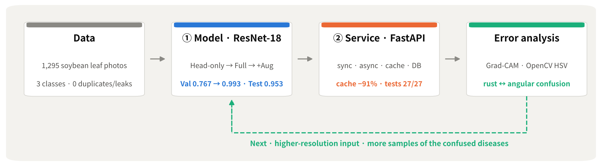
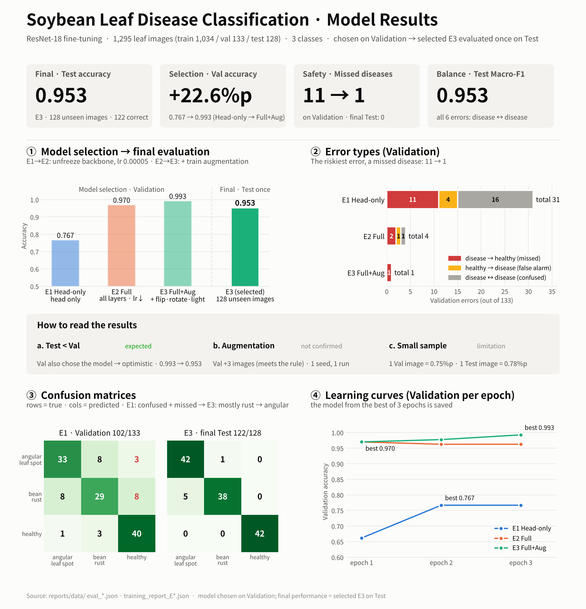
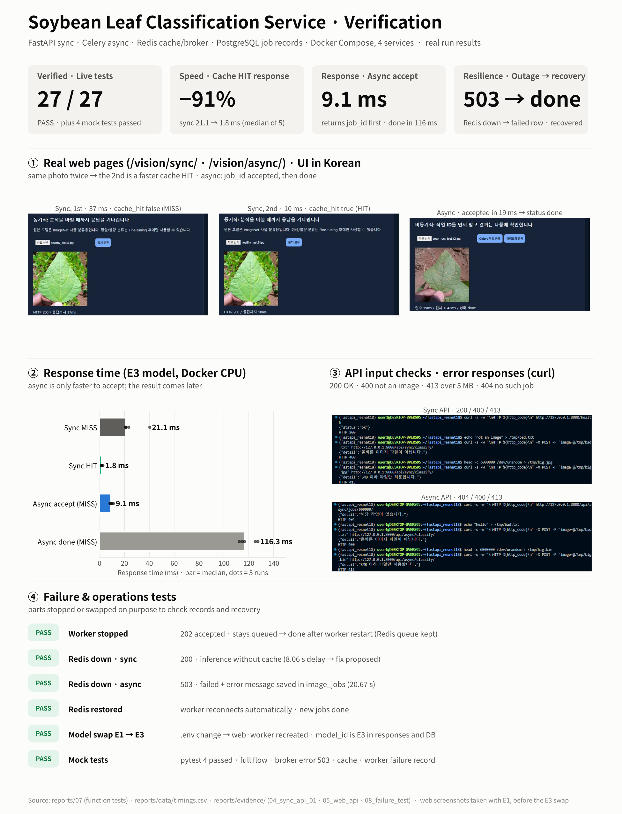

<div align="center">

# Soybean Leaf Disease Classification · From Fine-tuning to Sync/Async Serving

</div>

<p align="center">
       <br>
      
</p>

<p align="center"><a href="https://www.figma.com/design/8mR9Tlh6hyFZhOcblq2dWG/Soybean_Leaf_Identifier"></a></p>

[한국어](README.md) | **English**

I fine-tuned ResNet-18 on 1,295 soybean leaf photos into a 3-class classifier (**angular leaf spot · bean rust · healthy**) and deployed it as four Docker Compose services: a sync API, a Redis cache, Celery async jobs, and PostgreSQL job records.
After diagnosing why the baseline fell short, I raised Validation accuracy from **0.767 to 0.993** in two steps, **unfreezing the backbone → Train augmentation**, and evaluated the selected model **once** on a Test set it had never seen (**0.953**).

> 📑 The technical reports (01–09) are written in Korean. The tables and figures carry the key numbers.

## At a Glance

<p align="center">
  
</p>

<table>
  <tr>
    <th width="10%"></th>
    <th width="45%">① Model</th>
    <th width="45%">② Service</th>
  </tr>
  <tr>
    <td align="center"><b>What I did</b></td>
    <td>Data check → Head-only baseline → Full Fine-tuning · augmentation experiments → selection on Val → Test once → error analysis</td>
    <td>Sync API + Redis cache · Celery async · PostgreSQL records · model swap · failure tests</td>
  </tr>
  <tr>
    <td align="center"><b>Key numbers</b></td>
    <td>Val <b>0.767 → 0.993</b> · final Test <b>0.953</b> · missed diseased leaves Val <b>11 → 1</b>, Test <b>0</b></td>
    <td>Cache HIT <b>−91%</b> · async accept <b>9.1 ms</b> · live tests <b>27 / 27 PASS</b></td>
  </tr>
  <tr>
    <td align="center"><b>Docs</b></td>
    <td><a href="reports/01_FineTuning_결과보고서.md">Fine-tuning report</a> · <a href="reports/09_성능분석_개선보고서.md">Analysis &amp; improvement</a></td>
    <td><a href="reports/02_시스템_아키텍처.md">Architecture</a> · <a href="reports/06_성능비교_보고서.md">Performance</a> · <a href="reports/07_기능테스트_오류분석.md">Function tests</a></td>
  </tr>
  <tr>
    <td align="center"><b>Overview</b></td>
    <td align="center" valign="top"><br>Model selection · final evaluation · error types</td>
    <td align="center" valign="top"><br>Web pages · response time · API and failure tests</td>
  </tr>
</table>

### Experiment Design — One Change at a Time

| Run | What changed | Trained part | Learning rate | Train augmentation | Validation |
|---|---|---|---:|---|---:|
| **E1** Head-only (baseline) | Backbone frozen (`--freeze-backbone`) | Final classification head only (1,539 params) | 0.0002 | None | 0.767 |
| **E2** Full Fine-tuning | Backbone unfrozen + ¼ learning rate | **Everything incl. backbone** (about 11.18M params) | 0.00005 | None (left out to isolate the Full effect) | 0.970 |
| **E3** Full + Aug ⭐ | E2 plus **Train augmentation only** | Everything | 0.00005 | Horizontal flip (50%) · rotation ±20° · brightness/contrast ±20% | **0.993** |

- **Why Full Fine-tuning:** E1 keeps the "eyes" learned on ImageNet (the backbone) frozen and trains only the last layer. It stalled at Val 0.767, and 16 of its 31 errors were confusions between the two diseases. E2 retrains the backbone for soybean lesions too, with the learning rate cut to ¼ so the pretrained features are not destroyed.
- **Why this augmentation:** to make the model robust to shooting angle and lighting, each Train photo is randomly flipped, rotated, and re-lit every time it is read (the number of photos stays the same). Bean rust (reddish brown) and angular leaf spot (yellowish brown) are told apart by color, so **hue and saturation are not changed.** Validation and Test are never augmented.
- Common: epochs 3 · batch 8 · seed 42 · same Train/Validation · each run saves the model from its best Validation epoch (E1: 2 · E2: 1 · E3: 3)
- Run IDs: the baseline was called **E0** during the work, so some evaluation screenshots still show `E0_headonly` (now `E1_headonly`, same numbers). The `e3` in training log names (`train_full_e3.log` etc.) means **epochs 3**, not run E3.

## What I Built

| Item | Details |
|---|---|
| Type | Personal project (solo) — data checks · experiment design · service verification · error analysis · documentation |
| Period | 2026-11-04 \~ 11-05 |
| Outcome | Served model E3 · live tests 27 / 27 PASS · 9 technical reports |

<details>
<summary><b>Details</b> — data integrity check · E1→E3 experiment design · evaluation tool · failure tests · Grad-CAM · OpenCV analysis</summary>

**① Data · model**
- Data integrity check: per-class counts · SHA-256 duplicates · cross-split leaks · label conflicts, all 0 ([31c00f2])
- Baseline diagnosis → experiment design: Head-only → Full (¼ learning rate) → Train augmentation, changing one condition per run ([a2010d7])
- Wrote the augmentation wrapper `finetune_aug.py`, which swaps only the Dataset class and leaves the training code untouched (hue and saturation excluded)
- Evaluation tool `evaluate_split.py`: confusion matrix · P/R/F1 · top-1/top-2 score-margin bins · list of errors → **select on Val, Test only once at the end** ([7080e42])

**② Service verification**
- Swapped the served model with `.env` alone, no code change, and confirmed it via `model_id` in responses and in the DB ([6c055d7])
- Timing script: sync/async × cache MISS/HIT, 5 runs each, with the first request (model loading) kept separate ([6c055d7])
- Failure tests: stopped the worker and Redis on purpose → sync falls back to 200 · async returns 503 and records `failed` · automatic reconnection ([a2d0556])

**③ Error analysis**
- Grad-CAM comparison of E1 and E3: E1 tends to look at the background, E3 at the leaf · bean rust ↔ angular leaf spot confusion still remains ([a361c75])
- OpenCV HSV lesion-candidate area analysis and auxiliary-rule simulation: bean rust 0.0067 ≈ healthy 0.0068, so color rules alone cannot separate them ([2316a3c])

**④ Documentation**
- 9 technical reports · sync/async processing-flow diagrams down to file, function, and line number · `make_figures.py`, which draws every figure from the raw data (Korean/English)

> The serving skeleton (FastAPI routers · Celery task · Docker Compose) and the base training script started from a course lab template. Everything above was designed and built on top of it.

</details>

## Technical Reports

Reports are in Korean.

| # | Document | Key content |
|---:|---|---|
| 1 | [Fine-tuning results](reports/01_FineTuning_결과보고서.md) | Data check · E1/E2/E3 · selection on Val · Test once · model swap |
| 2 | [System architecture](reports/02_시스템_아키텍처.md) | Docker Compose, 4 services · roles of Redis DB1/2/3 |
| 3 | [API specification](reports/03_API_명세서.md) | 6 APIs · real response JSON · 400/413/404/503 |
| 4 | [DB schema · job history](reports/04_DB_구조_작업이력.md) | DDL · state transitions · jobs 1\~21 (including `failed`) |
| 5 | [AI button processing flow](reports/05_AI버튼_처리흐름.md) | Sync and async flow diagrams (files · functions · line numbers) · code map |
| 6 | [Performance comparison](reports/06_성능비교_보고서.md) | `timings.csv` · reading the cache and async results |
| 7 | [Function tests · errors](reports/07_기능테스트_오류분석.md) | 27 live tests · 2 mock tests · 12 errors |
| 8 | [**Final technical report**](reports/08_최종기술보고서.md) | Summary · improvement techniques ①\~④ · limitations · proposals |
| 9 | [Performance analysis · improvement](reports/09_성능분석_개선보고서.md) | Problems P1\~P5 → causes → fixes → re-verification |

<details>
<summary><b>Quick start</b> — place data → train → <code>docker compose up</code> (data, models and <code>.env</code> are not in the repo)</summary>

```bash
# 1. Environment (WSL2 Ubuntu 22.04 · Python 3.11 · Docker Desktop WSL Integration)
uv venv --python 3.11 && source .venv/bin/activate
uv pip install -r requirements.txt

# 2. Data: download the Hugging Face beans zips and place them as dataset/train · val · test
mkdir -p dataset
unzip -q ~/beans_source/train.zip -d dataset/
unzip -q ~/beans_source/validation.zip -d dataset/ && mv dataset/validation dataset/val
unzip -q ~/beans_source/test.zip -d dataset/
python scripts/check_dataset.py                          # 1034 / 133 / 128, 0 duplicates or leaks

# 3. Training (GPU) — E3 is the served model
python -m training.finetune     --data dataset --output artifacts/beans_resnet18          --epochs 3 --batch-size 8 --freeze-backbone
python -m training.finetune     --data dataset --output artifacts/beans_resnet18_full     --epochs 3 --batch-size 8 --lr 0.00005
python -m training.finetune_aug --data dataset --output artifacts/beans_resnet18_full_aug --epochs 3 --batch-size 8 --lr 0.00005

# 4. Service
cp .env.example .env
sed -i 's#^MODEL_PATH=.*#MODEL_PATH=artifacts/beans_resnet18_full_aug#' .env
mkdir -p artifacts media/jobs
docker compose up -d --build
curl -s http://127.0.0.1:8000/health ; echo             # pages: /vision/sync/ · /vision/async/ · /docs
# check: /health → {"status":"ok"} · sync → top1·cache_hit · async → 202·job_id → done · a row in DB image_jobs
# switch to the Head-only model (E1): sed -i 's#^MODEL_PATH=.*#MODEL_PATH=artifacts/beans_resnet18#' .env && docker compose up -d --force-recreate web worker
docker compose stop                                      # stop (do not use down -v; it deletes the DB and cache)

# 5. Tests · analysis
python -m pytest -q tests/test_api.py                    # mock tests: 4 passed
python scripts/measure_timings.py --repeat 5             # with the server running → reports/data/timings.csv
uv pip install opencv-python-headless matplotlib         # for analysis and figures only
python scripts/hsv_rule_analysis.py && python scripts/make_figures.py
```

</details>

<details>
<summary><b>Main tools</b> — training · serving · evaluation · analysis</summary>

| Area | File | What it does |
|---|---|---|
| Training | `training/finetune.py` | ResNet-18 fine-tuning (Head-only / Full), saves the best Validation epoch |
| Training | `training/finetune_aug.py` | Swaps only the Dataset to augment Train (E3) |
| Serving | `ai/router_sync.py` · `ai/router_async.py` | Sync classification API · async accept (202) / status APIs |
| Serving | `ai/cache_service.py` | Redis result cache keyed by image SHA-256 + model path (10 min) |
| Serving | `ai/tasks.py` | Celery worker inference · PostgreSQL status records (queued → running → done/failed) |
| Data | `scripts/check_dataset.py` | Per-class counts, SHA-256 duplicate / leak / label-conflict check |
| Evaluation | `scripts/evaluate_split.py` | Accuracy · confusion matrix · P/R/F1 · score-margin bins · list of errors |
| Timing | `scripts/measure_timings.py` | Repeated sync/async × MISS/HIT timing, warm-up kept separate |
| Analysis | `scripts/gradcam.py` · `scripts/hsv_rule_analysis.py` | Grad-CAM on errors · OpenCV HSV lesion-candidate analysis + auxiliary rule simulation |
| Figures | `scripts/make_figures.py` | Reads only the raw files in `reports/data` to draw dashboards and charts (Korean + English `.en`) |

</details>

<details>
<summary><b>Folder structure</b></summary>

```text
├── ai/ · main.py          # model loading · inference service · routers · cache · Celery · DB
├── training/              # finetune.py (base training) · finetune_aug.py (augmented training)
├── scripts/               # check · evaluate · measure · analyze · draw
├── templates/ · static/   # sync and async web pages
├── tests/                 # test_api.py (mock API tests) · legacy_01/ (early sync API tests)
├── compose.yaml · Dockerfile · requirements.txt · .env.example
├── reports/
│   ├── 01_*.md ~ 09_*.md  # technical reports (Korean)
│   ├── data/              # raw results (training reports · evaluations · timings · HSV)
│   ├── figures/           # pipeline · model/service boards (*.en.png = English) · charts · diagrams · gradcam · hsv
│   └── evidence/          # run screenshots 00_env ~ 08_failure_test (by stage)
└── artifacts/ · media/    # models · uploaded images (excluded from Git, folders kept)
```

</details>

<details>
<summary><b>Environment · security · limitations</b></summary>

- **Environment:** WSL2 Ubuntu 22.04.5 · Python 3.11.16 · transformers 4.57.6 · RTX 3060 (training) · Docker 29.9.2 / Compose v5.6.1 · inference on CPU in containers
- **Security:** `.env` · `dataset/` · `artifacts/` · `media/jobs/` are excluded from Git. The DB password in `compose.yaml` is a local development default (ports bound to `127.0.0.1` only) → move it to `.env` for production
- **Limitations:**
  1. All 6 Test errors are bean rust ↔ angular leaf spot confusions (bean rust Recall 0.88) → [analysis report](reports/09_성능분석_개선보고서.md)
  2. Single-source data — on internet soybean photos the model scored bean_rust 0.414 vs healthy 0.410, effectively no decision; non-leaf photos are also forced into one of the 3 classes
  3. One run per experiment (seed 42) — E2 → E3 differs by 3 Val images, so the augmentation effect is not confirmed
  4. With Redis stopped, sync took 8.06 s to return 200 and async 20.67 s to return 503 · concurrent load not measured
- **Sources:** data [AI-Lab-Makerere/beans](https://huggingface.co/datasets/AI-Lab-Makerere/beans) · model [microsoft/resnet-18](https://huggingface.co/microsoft/resnet-18)

</details>

[31c00f2]: https://github.com/yonghoonchoi88/Soybean_Leaf_Identifier/commit/31c00f2
[a2010d7]: https://github.com/yonghoonchoi88/Soybean_Leaf_Identifier/commit/a2010d7
[7080e42]: https://github.com/yonghoonchoi88/Soybean_Leaf_Identifier/commit/7080e42
[6c055d7]: https://github.com/yonghoonchoi88/Soybean_Leaf_Identifier/commit/6c055d7
[a2d0556]: https://github.com/yonghoonchoi88/Soybean_Leaf_Identifier/commit/a2d0556
[a361c75]: https://github.com/yonghoonchoi88/Soybean_Leaf_Identifier/commit/a361c75
[2316a3c]: https://github.com/yonghoonchoi88/Soybean_Leaf_Identifier/commit/2316a3c
