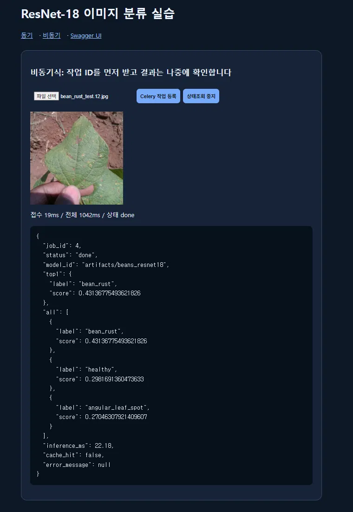
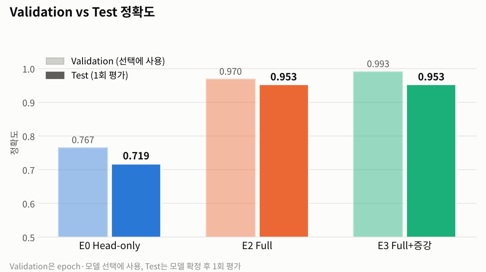
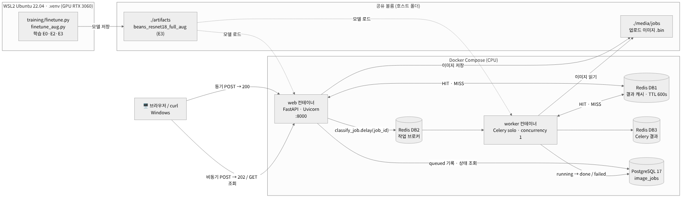

<div align="center">

# 콩잎 질병 분류 · Fine-tuning부터 동기·비동기 서빙까지

**ResNet-18 · FastAPI · Redis · Celery · PostgreSQL · Docker Compose**

</div>

콩잎 사진 1,295장으로 ResNet-18을 **반점병 · 녹병 · 정상** 3클래스로 Fine-tuning하고, 동기 API · Redis 캐시 · Celery 비동기 작업 · PostgreSQL 작업 기록을 Docker Compose로 묶어 서비스했습니다.
제공 코드 그대로의 기준선에서 **원인을 진단하고 한 번에 한 조건만 바꿔** 개선했으며, 모델은 Validation으로 고르고 **Test는 확정 후 한 번만** 평가했습니다. 서비스는 worker 정지 · Redis 장애 · 모델 교체까지 직접 확인했습니다.

<p align="center">
  
</p>

## 한눈에 보기

| | 모델 (Fine-tuning) | 서비스 (FastAPI · Redis · Celery · PostgreSQL) |
|---|---|---|
| **한 일** | 데이터 점검 → Head-only 기준선 → Full Fine-tuning · 증강 실험 → Val 선택 → Test 1회 → 오답 분석(Grad-CAM · OpenCV HSV) | 동기 API + Redis 캐시 · Celery 비동기 · PostgreSQL 기록 · Docker Compose 4서비스 · 모델 교체 · 장애 테스트 |
| **핵심 숫자** | Test 정확도 **0.719 → 0.953** · 병든 잎을 정상으로 놓침 **13 → 0** · Val 재현 3/3 일치 | 캐시 HIT 응답 **−91%** (21.1 → 1.8ms) · 비동기 접수 **9.1ms** · 실환경 테스트 **27/27 PASS** |
| **정직하게 남긴 것** | 증강 효과는 Test 동점이라 **확정하지 않음** · 색 규칙은 효과가 없어 **기각** | Redis 장애 시 응답 8초·20초 지연을 찾아 **개선안으로 이관** |
| **기록** | [산출물 1 Fine-tuning](reports/01_FineTuning_결과보고서.md) | [산출물 2~7](#산출물) |

<table>
  <tr>
    <td width="50%"></td>
    <td width="50%"></td>
  </tr>
  <tr>
    <td align="center"><sub>실제 서비스 화면 · 비동기 접수 → Celery 처리 → done</sub></td>
    <td align="center"><sub>E0 → E2 → E3 · Validation은 선택에, Test는 1회 평가에만 사용</sub></td>
  </tr>
</table>

## 실험 결과

| ID | 학습 방식 | 실행 옵션 (제공 코드 미수정) | Best Val | **Test** | 병을 놓침 |
|---|---|---|---:|---:|---:|
| E0 | Head-only (필수 기준선) | `--freeze-backbone`, lr 0.0002 | 0.767 | **0.719** | 13 |
| E2 | Full Fine-tuning | lr 0.00005 | 0.970 | **0.953** | 0 |
| **E3** ⭐ | Full + Train 증강 | E2 + `training/finetune_aug.py` | 0.993 | **0.953** | **0** |

- 모델 선택 규칙("E3가 E2보다 Val 2장 이상 많이 맞히면 E3")을 **실험 전에** 정했고, 그 규칙대로 E3를 서비스 모델로 골랐습니다.
- Test가 Val보다 낮은 이유, 증강 효과를 확정하지 않은 이유는 [산출물 1](reports/01_FineTuning_결과보고서.md)과 [산출물 8](reports/08_최종기술보고서.md)에 있습니다.

## 시스템 구조

<p align="center"></p>

| 경로 | 흐름 | 응답 (E3 · Docker CPU · 5회 중앙값) |
|---|---|---|
| 동기 MISS | 브라우저 → web → Redis(MISS) → ResNet-18 → 200 | 21.09 ms |
| 동기 HIT | 브라우저 → web → Redis(HIT) → 200 | **1.84 ms** |
| 비동기 | 브라우저 → web → PostgreSQL `queued` → Redis 브로커 → worker → `done` → 조회 | 접수 **9.12 ms** · 완료 116.35 ms |

## 빠른 실행 (재현 안내)

> 데이터셋 · 학습된 모델 · `.env`는 저장소에 없습니다. 아래 순서로 직접 준비합니다.

<details open>
<summary><b>1. 환경</b> — Windows + WSL2 Ubuntu 22.04 · Python 3.11 (uv) · Docker Desktop (WSL Integration 켜기)</summary>

```bash
git clone https://github.com/yonghoonchoi88/Soybean_Leaf_Identifier.git fastapi_resnet18
cd fastapi_resnet18
uv venv --python 3.11 && source .venv/bin/activate
uv pip install -r requirements.txt
```

</details>

<details open>
<summary><b>2. 데이터</b> — 원본 zip은 보존하고, 제공 코드가 읽는 <code>dataset/train · val · test</code>로 배치</summary>

```bash
# 원본: ~/beans_source/{train,validation,test}.zip  (Hugging Face AI-Lab-Makerere/beans)
mkdir -p dataset
unzip -q ~/beans_source/train.zip -d dataset/
unzip -q ~/beans_source/validation.zip -d dataset/ && mv dataset/validation dataset/val   # 코드는 val 폴더를 읽음
unzip -q ~/beans_source/test.zip -d dataset/
python scripts/check_dataset.py      # 1034 / 133 / 128장, 중복·누출 0 확인
```

</details>

<details open>
<summary><b>3. 학습</b> — WSL GPU에서 실행, 각 실험은 별도 폴더에 저장</summary>

```bash
# E0 (필수 기준선)
python -m training.finetune --data dataset --output artifacts/beans_resnet18 --epochs 3 --batch-size 8 --freeze-backbone
# E2 (Full Fine-tuning)
python -m training.finetune --data dataset --output artifacts/beans_resnet18_full --epochs 3 --batch-size 8 --lr 0.00005
# E3 (Full Fine-tuning + 증강, 서비스 모델)
python -m training.finetune_aug --data dataset --output artifacts/beans_resnet18_full_aug --epochs 3 --batch-size 8 --lr 0.00005
```

</details>

<details open>
<summary><b>4. 서비스 실행</b> — Redis · PostgreSQL · web · worker 한 번에</summary>

```bash
cp .env.example .env
sed -i 's#^MODEL_PATH=.*#MODEL_PATH=artifacts/beans_resnet18_full_aug#' .env   # 서비스 모델 E3
docker compose up -d --build
docker compose ps                       # redis·postgres·web healthy, worker Up
curl -s http://127.0.0.1:8000/health ; echo
```

| 주소 | 내용 |
|---|---|
| http://127.0.0.1:8000/vision/sync/ | 동기 분류 화면 |
| http://127.0.0.1:8000/vision/async/ | 비동기 분류 화면 |
| http://127.0.0.1:8000/docs | Swagger API 문서 |

```bash
# 모델 경로를 바꿨을 때 (web·worker만 다시 생성)
docker compose up -d --force-recreate web worker
# 정지 (데이터 보존) — docker compose down -v 는 DB·캐시 볼륨을 지우므로 사용하지 않음
docker compose stop
```

</details>

<details>
<summary><b>5. 테스트 · 평가 · 분석</b> — 모의 테스트, Val/Test 평가, 응답 시간, Grad-CAM, HSV</summary>

```bash
python -m pytest -q tests/test_api.py                                 # 모의 테스트 4 passed (Docker 불필요)
python scripts/evaluate_split.py --model artifacts/beans_resnet18_full_aug --split val --tag E3_full_aug
python scripts/measure_timings.py --repeat 5                          # 서버 실행 중 → reports/data/timings.csv
python scripts/gradcam.py --model artifacts/beans_resnet18_full_aug \
  --from-eval reports/data/eval_test_E3_full_aug.json reports/data/eval_val_E3_full_aug.json \
  --compare-model artifacts/beans_resnet18
uv pip install opencv-python-headless matplotlib                      # 분석·그림 전용 (서비스에는 불필요)
python scripts/hsv_rule_analysis.py
python scripts/make_figures.py                                        # reports/data → reports/figures 그림 재생성
```

</details>

## 산출물

| # | 문서 | 내용 |
|---:|---|---|
| 1 | [Fine-tuning 결과보고서](reports/01_FineTuning_결과보고서.md) | 데이터 점검 · E0/E2/E3 · Val 재현 · Test 1회 · 모델 교체 |
| 2 | [시스템 아키텍처](reports/02_시스템_아키텍처.md) | Docker Compose 4서비스 · Redis DB1/2/3 역할 · 실행 환경 |
| 3 | [API 명세서](reports/03_API_명세서.md) | 6개 API · 입력 검증 · 실제 응답 JSON · 400/413/404/503 |
| 4 | [DB 구조 · 작업이력](reports/04_DB_구조_작업이력.md) | DDL · 상태 전이 · job 1~21 이력 (`failed` 포함) |
| 5 | [AI 버튼 처리흐름](reports/05_AI버튼_처리흐름.md) | 동기·비동기 시퀀스도 · 코드 연결표 |
| 6 | [성능 비교](reports/06_성능비교_보고서.md) | `timings.csv` · 캐시·비동기 해석 · 장애 시 지연 |
| 7 | [기능 테스트 · 오류](reports/07_기능테스트_오류분석.md) | 실환경 27건 · 모의 2건 · 오류 12건 |
| 8 | [최종 기술 보고서](reports/08_최종기술보고서.md) | 종합 · 개선 기술 ①~④ · 한계 · 발표 흐름 · 예상 질문 |

<details>
<summary><b>추가한 도구</b> — 제공 코드는 수정하지 않고 7개 파일을 추가</summary>

| 파일 | 하는 일 | 산출물 |
|---|---|---|
| `scripts/check_dataset.py` | 클래스별 개수, SHA-256 기반 중복·누출·라벨 충돌 점검 | 1 |
| `training/finetune_aug.py` | 제공 `finetune.py`를 재사용하며 Train에만 증강 적용 (E3) | 1, 8 |
| `scripts/evaluate_split.py` | Val/Test 전체 평가: 정확도, 혼동행렬, P/R/F1, margin 구간, 오답 목록 | 1, 8 |
| `scripts/measure_timings.py` | 동기/비동기 × MISS/HIT 반복 측정, 워밍업 분리 → `timings.csv` | 6 |
| `scripts/gradcam.py` | 오답 사진의 Grad-CAM, 다른 모델과 비교 | 8 |
| `scripts/hsv_rule_analysis.py` | OpenCV HSV 병반 후보 분석 + 보조 규칙 시뮬레이션 (Val 설계 → Test 1회) | 8 |
| `scripts/make_figures.py` | `reports/data`의 원본만 읽어 대시보드·그래프 생성 | README, 1, 6, 8 |

</details>

<details>
<summary><b>폴더 구조</b></summary>

```text
fastapi_resnet18/
├── ai/                  # 제공 코드: 모델 로드, 서비스, 라우터, 캐시, Celery, DB
├── training/            # 제공 finetune.py + 추가 finetune_aug.py
├── scripts/             # 추가 도구 (점검·평가·측정·분석·그림)
├── templates/ static/   # 제공 웹 화면
├── tests/test_api.py    # 02 모의 테스트 (루트 test_api.py는 01용)
├── main.py  compose.yaml  Dockerfile  requirements.txt  .env.example
├── reports/
│   ├── 01_*.md ~ 08_*.md
│   ├── data/            # 원본 결과: training_report_E*.json, eval_*.json/csv, timings*.csv, hsv_*
│   ├── figures/         # 대시보드·그래프·구성도·gradcam/·hsv/
│   └── evidence/        # 실행 캡처·학습 로그
├── dataset/             # (Git 제외) train / val / test
├── artifacts/           # (Git 제외) beans_resnet18 · _full · _full_aug
└── media/jobs/          # (Git 제외) 비동기 업로드 이미지
```

</details>

<details>
<summary><b>환경 · 보안 · 한계</b></summary>

- **환경:** WSL2 Ubuntu 22.04.5 · Python 3.11.16 · transformers 4.57.6 · RTX 3060 12GB(학습) · Docker 29.9.2 / Compose v5.6.1 · 컨테이너 추론은 CPU (torch 2.5.1 CPU)
- **보안:** `.env` · `dataset/` · `artifacts/` · `media/jobs/`는 `.gitignore`로 제외. `compose.yaml`의 DB 비밀번호는 교재 제공 로컬 실습값이며 포트는 `127.0.0.1`에만 바인딩 → 운영 시 `.env` 분리 권장
- **한계:** 단일 출처 데이터, Test 128장, 실험당 1회 실행, 동시 부하 미측정, 학습 범위 밖 입력(예: 고양이 사진)도 3클래스 중 하나로 분류
- **데이터 출처:** [AI-Lab-Makerere/beans](https://huggingface.co/datasets/AI-Lab-Makerere/beans) · 모델: [microsoft/resnet-18](https://huggingface.co/microsoft/resnet-18)

</details>
