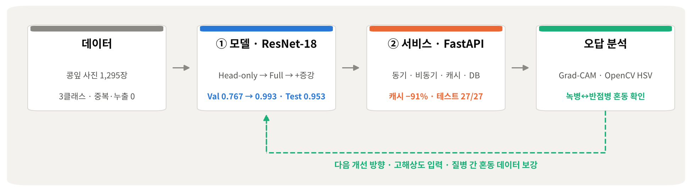
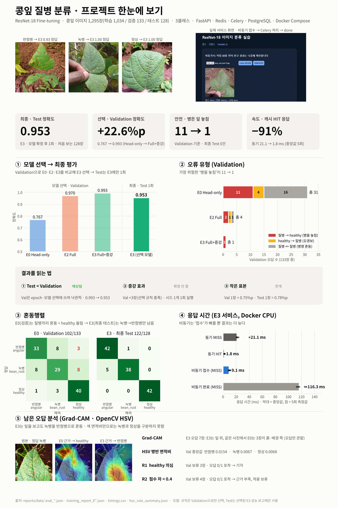
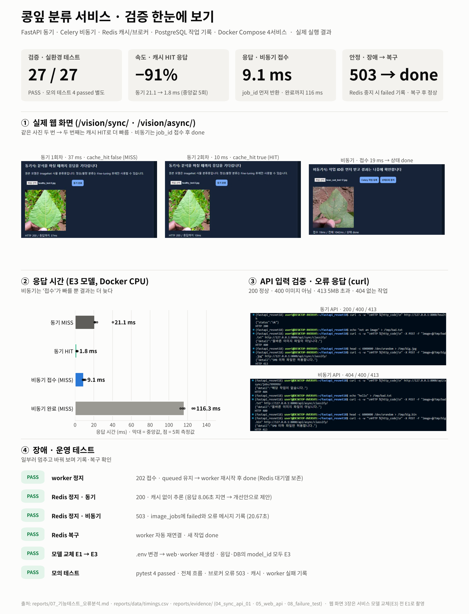

**한국어** | [English](README.en.md)

<div align="center">

# 콩잎 질병 분류 · Fine-tuning부터 동기·비동기 서빙까지

</div>

<p align="center">
       <br>
      
</p>

<p align="center"><a href="https://www.figma.com/design/8mR9Tlh6hyFZhOcblq2dWG/Soybean_Leaf_Identifier"></a></p>

콩잎 사진 1,295장으로 ResNet-18을 **반점병 · 녹병 · 정상** 3클래스 분류기로 Fine-tuning하고, 동기 API · Redis 캐시 · Celery 비동기 작업 · PostgreSQL 작업 기록을 Docker Compose 4개 서비스로 배포했습니다.
기준선이 낮은 원인을 진단해 **Backbone 동결 해제 → Train 증강** 순서로 Validation 정확도를 **0.767 → 0.993**까지 올렸고, 선택한 모델은 한 번도 쓰지 않은 Test에서 **한 번만** 평가했습니다(**0.953**).

## 한눈에 보기

<p align="center">
  
</p>

<table>
  <tr>
    <th width="10%"></th>
    <th width="45%">① 모델</th>
    <th width="45%">② 서비스</th>
  </tr>
  <tr>
    <td align="center"><b>한 일</b></td>
    <td>데이터 점검 → Head-only 기준선 → Full Fine-tuning · 증강 실험 → Val 선택 → Test 1회 → 오답 분석</td>
    <td>동기 API + Redis 캐시 · Celery 비동기 · PostgreSQL 기록 · 모델 교체 · 장애 테스트</td>
  </tr>
  <tr>
    <td align="center"><b>핵심 숫자</b></td>
    <td>Val <b>0.767 → 0.993</b> · 최종 Test <b>0.953</b> · 병든 잎 놓침 Val <b>11 → 1</b>, Test <b>0</b></td>
    <td>캐시 HIT <b>−91%</b> · 비동기 접수 <b>9.1 ms</b> · 실환경 테스트 <b>27 / 27 PASS</b></td>
  </tr>
  <tr>
    <td align="center"><b>문서</b></td>
    <td><a href="reports/01_FineTuning_결과보고서.md">Fine-tuning 보고서</a> · <a href="reports/09_성능분석_개선보고서.md">성능 분석 · 개선</a></td>
    <td><a href="reports/02_시스템_아키텍처.md">아키텍처</a> · <a href="reports/06_성능비교_보고서.md">성능 비교</a> · <a href="reports/07_기능테스트_오류분석.md">기능 테스트</a></td>
  </tr>
  <tr>
    <td align="center"><b>한눈에</b></td>
    <td align="center" valign="top"><br>모델 선택 · 최종 평가 · 오류 유형</td>
    <td align="center" valign="top"><br>웹 화면 · 응답 시간 · API·장애 테스트</td>
  </tr>
</table>

### 실험 설계 — 한 번에 하나씩 바꾸기

| 실험 | 바꾼 것 | 학습되는 부분 | 학습률 | Train 증강 | Validation |
|---|---|---|---:|---|---:|
| **E1** Head-only (기준선) | Backbone 고정 (`--freeze-backbone`) | 마지막 분류 헤드만 (1,539개) | 0.0002 | 없음 | 0.767 |
| **E2** Full Fine-tuning | Backbone 동결 해제 + 학습률 ¼ | **Backbone 포함 전체** (약 1,118만 개) | 0.00005 | 없음 (Full 효과만 보려고 뺌) | 0.970 |
| **E3** Full + 증강 ⭐ | E2에 **Train 증강만** 추가 | 전체 | 0.00005 | 좌우 반전(50%) · 회전 ±20° · 밝기·대비 ±20% | **0.993** |

- **왜 Full Fine-tuning인가:** E1은 ImageNet에서 배운 "눈"(Backbone)을 그대로 두고 마지막 층만 학습해 Val 0.767에서 멈췄고, 오답 31장 중 16장이 질병 간 혼동이었다. E2는 Backbone까지 콩잎 병반에 맞게 다시 학습하고, 사전학습 특징이 망가지지 않도록 학습률을 ¼로 낮췄다.
- **왜 이 증강인가:** 촬영 방향·조명 차이에 강해지도록 학습 중 사진을 읽을 때마다 무작위로 뒤집고·돌리고·밝기를 바꾼다(사진 수는 그대로). 녹병(적갈색)과 반점병(황갈색)은 색이 단서라 **색조·채도는 바꾸지 않았다.** Validation · Test에는 적용하지 않는다.
- 공통: epochs 3 · batch 8 · seed 42 · 같은 Train/Validation · 각 실험은 Validation 최고 epoch의 모델을 저장 (E1 2 · E2 1 · E3 3)
- 실험 ID: 기준선은 작업 당시 **E0**로 불러, 일부 평가 화면 캡처에 `E0_headonly`가 남아 있다(현재 이름 `E1_headonly`, 수치 동일). 학습 로그 이름의 `e3`(`train_full_e3.log` 등)는 실험 E3가 아니라 **epochs 3**이다.

## 직접 한 일

| 항목 | 내용 |
|---|---|
| 형태 | 개인 프로젝트 (1인) — 데이터 점검 · 실험 설계 · 서빙 검증 · 오답 분석 · 문서화 |
| 기간 | 2026-11-04 \~ 11-05 |
| 결과 | 서비스 모델 E3 · 실환경 테스트 27 / 27 PASS · 기술 문서 9종 |

<details>
<summary><b>세부 내용</b> — 데이터 무결성 점검 · E1→E3 실험 설계 · 평가 도구 · 장애 테스트 · Grad-CAM · OpenCV 분석</summary>

**① 데이터 · 모델**
- 데이터 무결성 점검: 클래스별 개수 · SHA-256 중복 · Split 간 누출 · 라벨 충돌 0건 확인 ([31c00f2])
- 기준선 진단 → 실험 설계: Head-only → Full(학습률 ¼) → Train 증강, 실험마다 조건 하나만 변경 ([a2010d7])
- 학습 코드를 고치지 않고 Dataset 클래스만 교체하는 증강 래퍼 `finetune_aug.py` 작성 (색조 · 채도 제외)
- 평가 도구 `evaluate_split.py`: 혼동행렬 · P/R/F1 · 1·2위 점수 차 구간 · 오답 목록 → **Val로 선택, Test는 최종 1회** ([7080e42])

**② 서비스 검증**
- 모델 교체를 코드 수정 없이 `.env`만으로 수행하고, 응답과 DB의 `model_id`로 확인 ([6c055d7])
- 응답 시간 측정 스크립트: 동기/비동기 × 캐시 MISS/HIT 각 5회, 첫 요청(모델 로딩) 분리 ([6c055d7])
- 장애 테스트: worker · Redis를 일부러 정지 → 동기 200 폴백 · 비동기 503 + `failed` 기록 · 자동 재연결 확인 ([a2d0556])

**③ 오답 분석**
- Grad-CAM으로 E1 · E3의 주목 영역 비교: E1은 배경, E3는 잎에 주목하는 경향 · 그래도 녹병 ↔ 반점병 혼동은 남음 ([a361c75])
- OpenCV HSV 병반 후보 면적 분석과 보조 규칙 시뮬레이션: 녹병 0.0067 ≈ 정상 0.0068로 색 규칙만으로는 구분 어려움 ([2316a3c])

**④ 문서화**
- 기술 문서 9종 · 파일 · 함수 · 줄 번호 단위의 동기/비동기 처리 흐름도 · 원본 데이터에서 그림을 자동 생성하는 `make_figures.py` (한/영)

> 서빙 골격(FastAPI 라우터 · Celery 작업 · Docker Compose)과 기본 학습 스크립트는 교육 과정 실습 템플릿을 바탕으로 했고, 위 항목은 그 위에서 직접 설계 · 구현했습니다.

</details>

## 기술 문서

| # | 문서 | 핵심 |
|---:|---|---|
| 1 | [Fine-tuning 결과보고서](reports/01_FineTuning_결과보고서.md) | 데이터 점검 · E1/E2/E3 · Val 선택 · Test 1회 · 모델 교체 |
| 2 | [시스템 아키텍처](reports/02_시스템_아키텍처.md) | Docker Compose 4서비스 · Redis DB1/2/3 역할 |
| 3 | [API 명세서](reports/03_API_명세서.md) | 6개 API · 실제 응답 JSON · 400/413/404/503 |
| 4 | [DB 구조 · 작업이력](reports/04_DB_구조_작업이력.md) | DDL · 상태 전이 · job 1\~21 (`failed` 포함) |
| 5 | [AI 버튼 처리흐름](reports/05_AI버튼_처리흐름.md) | 동기·비동기 처리 흐름도 (파일·함수·줄 번호) · 코드 연결표 |
| 6 | [성능 비교](reports/06_성능비교_보고서.md) | `timings.csv` · 캐시·비동기 해석 |
| 7 | [기능 테스트 · 오류](reports/07_기능테스트_오류분석.md) | 실환경 27건 · 모의 2건 · 오류 12건 |
| 8 | [**최종 기술 보고서**](reports/08_최종기술보고서.md) | 종합 · 개선 기술 ①\~④ · 한계 · 개선 제안 |
| 9 | [성능 분석 · 개선 보고서](reports/09_성능분석_개선보고서.md) | 문제 P1\~P5 → 원인 → 개선 → 재검증 |

<details>
<summary><b>빠른 실행</b> — 데이터 배치 → 학습 → <code>docker compose up</code> (데이터·모델·<code>.env</code>는 저장소에 없음)</summary>

```bash
# 1. 환경 (WSL2 Ubuntu 22.04 · Python 3.11 · Docker Desktop WSL Integration)
uv venv --python 3.11 && source .venv/bin/activate
uv pip install -r requirements.txt

# 2. 데이터: Hugging Face beans zip을 받아 dataset/train · val · test 로 배치
mkdir -p dataset
unzip -q ~/beans_source/train.zip -d dataset/
unzip -q ~/beans_source/validation.zip -d dataset/ && mv dataset/validation dataset/val
unzip -q ~/beans_source/test.zip -d dataset/
python scripts/check_dataset.py                          # 1034 / 133 / 128, 중복·누출 0

# 3. 학습 (GPU) — E3가 서비스 모델
python -m training.finetune     --data dataset --output artifacts/beans_resnet18          --epochs 3 --batch-size 8 --freeze-backbone
python -m training.finetune     --data dataset --output artifacts/beans_resnet18_full     --epochs 3 --batch-size 8 --lr 0.00005
python -m training.finetune_aug --data dataset --output artifacts/beans_resnet18_full_aug --epochs 3 --batch-size 8 --lr 0.00005

# 4. 서비스
cp .env.example .env
sed -i 's#^MODEL_PATH=.*#MODEL_PATH=artifacts/beans_resnet18_full_aug#' .env
mkdir -p artifacts media/jobs
docker compose up -d --build
curl -s http://127.0.0.1:8000/health ; echo             # 화면: /vision/sync/ · /vision/async/ · /docs
# 확인: /health → {"status":"ok"} · 동기 → top1·cache_hit · 비동기 → 202·job_id → done · DB image_jobs 행
# Head-only 모델(E1)로 전환: sed -i 's#^MODEL_PATH=.*#MODEL_PATH=artifacts/beans_resnet18#' .env && docker compose up -d --force-recreate web worker
docker compose stop                                      # 정지 (down -v 는 DB·캐시를 지우므로 사용 안 함)

# 5. 테스트 · 분석
python -m pytest -q tests/test_api.py                    # 모의 테스트 4 passed
python scripts/measure_timings.py --repeat 5             # 서버 실행 중 → reports/data/timings.csv
uv pip install opencv-python-headless matplotlib         # 분석·그림 전용
python scripts/hsv_rule_analysis.py && python scripts/make_figures.py
```

</details>

<details>
<summary><b>주요 도구</b> — 학습 · 서빙 · 평가 · 분석</summary>

| 구분 | 파일 | 하는 일 |
|---|---|---|
| 학습 | `training/finetune.py` | ResNet-18 Fine-tuning (Head-only / Full), Validation 최고 epoch 저장 |
| 학습 | `training/finetune_aug.py` | Dataset만 교체해 Train에 증강 적용 (E3) |
| 서빙 | `ai/router_sync.py` · `ai/router_async.py` | 동기 분류 API · 비동기 접수(202) / 상태 조회 API |
| 서빙 | `ai/cache_service.py` | 이미지 SHA-256 + 모델 경로 키로 Redis 결과 캐시 (10분) |
| 서빙 | `ai/tasks.py` | Celery worker 추론 · PostgreSQL 상태 기록 (queued → running → done/failed) |
| 데이터 | `scripts/check_dataset.py` | 클래스별 개수, SHA-256 중복·누출·라벨 충돌 점검 |
| 평가 | `scripts/evaluate_split.py` | 정확도·혼동행렬·P/R/F1·점수 차 구간·오답 목록 |
| 측정 | `scripts/measure_timings.py` | 동기/비동기 × MISS/HIT 반복 측정, 워밍업 분리 |
| 분석 | `scripts/gradcam.py` · `scripts/hsv_rule_analysis.py` | 오답 Grad-CAM · OpenCV HSV 병반 후보 분석 + 보조 규칙 시뮬레이션 |
| 시각화 | `scripts/make_figures.py` | `reports/data` 원본만 읽어 대시보드·그래프 생성 (한글 + 영문 `.en`) |

</details>

<details>
<summary><b>폴더 구조</b></summary>

```text
├── ai/ · main.py          # 모델 로딩 · 추론 서비스 · 라우터 · 캐시 · Celery · DB
├── training/              # finetune.py (기본 학습) · finetune_aug.py (증강 학습)
├── scripts/               # 점검 · 평가 · 측정 · 분석 · 그림
├── templates/ · static/   # 동기 · 비동기 웹 화면
├── tests/                 # test_api.py (모의 API 테스트) · legacy_01/ (초기 동기 API 테스트)
├── compose.yaml · Dockerfile · requirements.txt · .env.example
├── reports/
│   ├── 01_*.md ~ 09_*.md  # 기술 문서
│   ├── data/              # 원본 결과 (학습 리포트·평가·응답 시간·HSV)
│   ├── figures/           # 파이프라인·모델/서비스 보드(*.en.png = 영문)·그래프·구성도·gradcam·hsv
│   └── evidence/          # 실행 캡처 00_env ~ 08_failure_test (단계별)
└── artifacts/ · media/    # 모델·업로드 이미지 (Git 제외, 폴더만 유지)
```

</details>

<details>
<summary><b>환경 · 보안 · 한계</b></summary>

- **환경:** WSL2 Ubuntu 22.04.5 · Python 3.11.16 · transformers 4.57.6 · RTX 3060(학습) · Docker 29.9.2 / Compose v5.6.1 · 컨테이너 추론 CPU
- **보안:** `.env` · `dataset/` · `artifacts/` · `media/jobs/`는 Git 제외. `compose.yaml`의 DB 비밀번호는 로컬 개발용 기본값(포트는 `127.0.0.1`에만 바인딩) → 운영 시 `.env`로 분리
- **한계:**
  1. Test 오답 6장이 모두 녹병 ↔ 반점병 혼동 (녹병 Recall 0.88) → [성능 분석 보고서](reports/09_성능분석_개선보고서.md)
  2. 단일 출처 데이터 — 인터넷 콩잎 사진은 bean_rust 0.414 vs healthy 0.410으로 사실상 판단 불가, 콩잎이 아닌 사진도 3클래스 중 하나로 분류
  3. 실험당 1회(seed 42) — E2 → E3 차이가 Val 3장이라 증강 효과는 확정하지 않음
  4. Redis 정지 시 동기 200까지 8.06초, 비동기 503까지 20.67초 지연 · 동시 부하 미측정
- **출처:** 데이터 [AI-Lab-Makerere/beans](https://huggingface.co/datasets/AI-Lab-Makerere/beans) · 모델 [microsoft/resnet-18](https://huggingface.co/microsoft/resnet-18)

</details>

[31c00f2]: https://github.com/yonghoonchoi88/Soybean_Leaf_Identifier/commit/31c00f2
[a2010d7]: https://github.com/yonghoonchoi88/Soybean_Leaf_Identifier/commit/a2010d7
[7080e42]: https://github.com/yonghoonchoi88/Soybean_Leaf_Identifier/commit/7080e42
[6c055d7]: https://github.com/yonghoonchoi88/Soybean_Leaf_Identifier/commit/6c055d7
[a2d0556]: https://github.com/yonghoonchoi88/Soybean_Leaf_Identifier/commit/a2d0556
[a361c75]: https://github.com/yonghoonchoi88/Soybean_Leaf_Identifier/commit/a361c75
[2316a3c]: https://github.com/yonghoonchoi88/Soybean_Leaf_Identifier/commit/2316a3c
