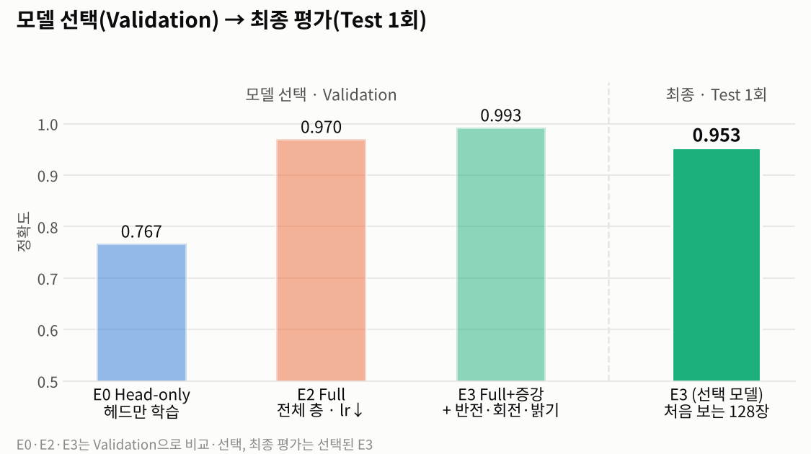
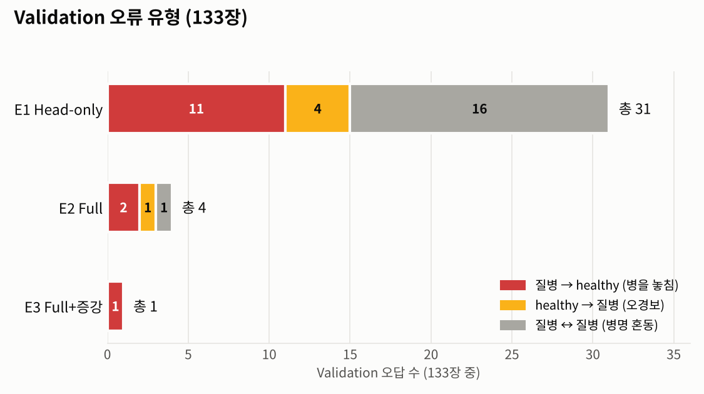
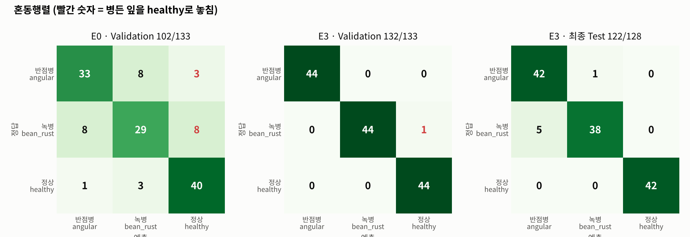

# 산출물 1. ResNet18 콩잎 3클래스 Fine-tuning 결과보고서

| 항목 | 내용 |
|---|---|
| 평가 대상 | 콩잎 이미지 3클래스 분류 (`angular_leaf_spot` 반점병 / `bean_rust` 녹병 / `healthy` 정상) |
| 기준 모델 | `microsoft/resnet-18` (ImageNet-1K 사전학습, Apache-2.0) |
| 필수 실험 | **E0 Head-only Fine-tuning** (Backbone 고정, 분류 헤드만 학습) |
| 선택 실험 | **E2 Full Fine-tuning**, **E3 Full Fine-tuning + 이미지 증강** |
| 모델 선택 | **Validation으로만** 비교, 실험 전에 정한 규칙으로 **E3** 선택 |
| 최종 평가 | 선택된 **E3를 Test 128장에 1회** 평가 |
| 서비스 모델 | E3 `artifacts/beans_resnet18_full_aug/` |
| 실행 일시 | 2026-11-04 |

## 0. 한눈에 보는 결과

| ID | 학습 방식 | Validation 정확도 | Val 병을 놓침 | 비고 |
|---|---|---:|---:|---|
| E0 | Head-only (필수 기준선) | 0.7669 (102/133) | 11 | |
| E2 | Full Fine-tuning | 0.9699 (129/133) | 2 | |
| **E3** ⭐ | Full Fine-tuning + 증강 | **0.9925** (132/133) | **1** | 선택 규칙 충족 → 서비스 모델 |

| 최종 평가 (E3, Test 1회) | 결과 |
|---|---|
| **Test 정확도** | **0.9531** (122/128) |
| Macro-F1 | 0.9534 |
| 병든 잎을 healthy로 놓침 | **0건** |
| 남은 오답 | 6건 모두 질병 간 혼동 (`bean_rust → angular_leaf_spot` 5, 반대 1) |



---

## 1. 실행 환경

| 항목 | 값 | 증빙 |
|---|---|---|
| OS | Windows + WSL2 Ubuntu 22.04.5 LTS (kernel 6.18.54.1-microsoft-standard-WSL2) | `evidence/00_env/env_versions.png` |
| Python | 3.11.16 (uv 가상환경 `.venv`) | `evidence/00_env/env_python_gpu.png` |
| 주요 라이브러리 | torch(CUDA) / transformers 4.57.6 (torch 버전 문자열은 증빙 캡처 기준) | `evidence/00_env/env_python_gpu.png` |
| 학습 장치 | **GPU: NVIDIA GeForce RTX 3060 12GB** (`torch.cuda.is_available() == True`) | `evidence/00_env/env_python_gpu.png` |
| 평가 장치 | CPU (`device=-1`, 서비스 `ai/hf_model.py`와 동일 조건) | 평가 로그 `Device set to use cpu` |
| 시드 | 42 (제공 코드 고정값) | `training/finetune.py` |

- `training/finetune.py`는 CUDA가 있으면 GPU를 자동 선택하지만 학습 로그에 장치명을 출력하지 않는다. 그래서 같은 가상환경에서 CUDA 사용 가능 여부를 따로 확인해 GPU 학습의 근거로 남겼다.

## 2. 데이터 구성 및 무결성 점검

### 2-1. 클래스별 이미지 수

| 클래스 | Train | Validation | Test |
|---|---:|---:|---:|
| angular_leaf_spot | 345 | 44 | 43 |
| bean_rust | 348 | 45 | 43 |
| healthy | 341 | 44 | 42 |
| **합계** | **1,034** | **133** | **128** |

- 세 클래스 비율이 약 1:1:1 → Accuracy 해석 시 불균형 영향이 작음
- 원본 기록: `reports/data/dataset_check.json`

### 2-2. 원본 보존 및 실행용 폴더 매핑

| 원본 (보존) | 실행용 (제공 코드가 읽는 경로) |
|---|---|
| `~/beans_source/train.zip` | `dataset/train/` |
| `~/beans_source/validation.zip` | **`dataset/val/`** (제공 코드는 `val` 폴더명을 요구) |
| `~/beans_source/test.zip` | `dataset/test/` |

증빙: `evidence/01_data/data_source_original.png`, `evidence/01_data/data_mapping.png`

### 2-3. 원본 zip 항목 수와 이미지 수 대조

`unzip -l`의 항목 수가 이미지 수와 달라 원인을 확인했다.

| zip | 전체 항목 | 이미지 (jpg/jpeg/png/webp) | 차이 원인 |
|---|---:|---:|---|
| train.zip | 1,039 | **1,034** | 폴더 항목 4 + **비이미지 파일 1** |
| validation.zip | 137 | **133** | 폴더 항목 4 |
| test.zip | 132 | **128** | 폴더 항목 4 |

- 비이미지 파일 `train/healthy/healthy_train.120tore` → `file` 판정 **Apple Desktop Services Store** (macOS `.DS_Store` 메타데이터)
- 같은 번호의 이미지는 없음 → **누락된 이미지 없음**. 학습 코드와 점검 스크립트 모두 확장자 필터로 제외
- 증빙: `evidence/01_data/data_odd_file_check.png`

### 2-4. 중복·누출 점검

- 도구: `scripts/check_dataset.py` (추가, 제공 코드 미수정) — 전체 이미지 SHA-256 비교
- 결과: **중복 그룹 0 / Split 간 누출 0 / 라벨 충돌 0** (`evidence/01_data/data_check_result.png`)
- 한계: 완전히 같은 파일만 검출. 같은 잎을 다시 찍은 유사 이미지는 확인하지 못함

---

## 3. 실험 설계

### 3-1. 실험 설계 — 바로 앞 단계와 비교

| ID | 구분 | 바꾼 조건 | 비교 대상 | 확인하려는 것 |
|---|---|---|---|---|
| E0 | 필수 | — (제공 명령 그대로) | — | 기준선 |
| E2 | 선택 | `--freeze-backbone` 제거, lr 0.00005 | E0 | 전체 층 학습 효과 |
| E3 | 선택 | E2와 동일 + **Train 이미지 증강** | E2 | 증강 효과 |

- 실험 ID는 E0 · E2 · E3 세 개다 (E1은 사용하지 않은 번호).
- E2 옵션은 평가 가이드 6-1 B의 샘플 실행 옵션과 같다 (epochs 3, batch 8, lr 0.00005).
- E0 → E2는 **동결 해제와 학습률 변경(0.0002 → 0.00005)을 한 묶음**으로 바꿨다(가이드 B 설정). 두 효과를 따로 분리하지 않았으므로 E2의 향상은 "Full Fine-tuning 설정"의 효과로 해석한다. E2 → E3는 **증강 하나만** 바꿨다.
- 학습률을 낮춘 이유: Full Fine-tuning은 ImageNet으로 이미 학습된 Backbone까지 고치므로, 큰 학습률은 사전학습 특징을 망가뜨릴 수 있다.

### 3-2. 평가 규칙 (실험 전에 정함)

1. 모델 비교·선택은 **Validation으로만** 한다.
2. E3 vs E2: E3가 **2장 이상** 더 맞히면 E3, ±1장 이내면 더 단순한 E2 (Val 1장 = 0.75%p라 우연과 구분하기 어려움)
3. Test는 **선택된 모델에 1회** 적용해 최종 성능으로 보고하고, 그 결과로 선택을 바꾸지 않는다.

### 3-3. 이미지 증강 설정 (E3)

| 증강 | 설정 | 의도 |
|---|---|---|
| RandomHorizontalFlip | p=0.5 | 촬영 방향이 달라도 병은 같다 |
| RandomRotation | ±20° | 잎 기울기 차이 |
| ColorJitter | brightness 0.2, contrast 0.2 | 햇빛·그늘 등 조명 차이 |
| hue / saturation | **변경 안 함** | 녹병(적갈색)·반점병(황갈색)은 **색이 핵심 단서** → 라벨과 맞지 않는 이미지가 생길 위험 |

- **Train에만** 적용, Validation에는 적용하지 않음
- 구현: `training/finetune_aug.py` — 제공 `finetune.py`를 **수정하지 않고** 학습 루프·시드·저장 방식을 그대로 쓰며, 이미지를 읽는 `FolderImages`만 증강 버전으로 바꿔 끼우는 래퍼

---

## 4. 실행 설정

| 파라미터 | E0 | E2 | E3 |
|---|---|---|---|
| 실행 파일 | `training/finetune.py` | `training/finetune.py` | `training/finetune_aug.py` |
| freeze_backbone | **True** | False | False |
| 학습 파라미터 | 분류 헤드만 (512×3+3 = 1,539개) | 전체 | 전체 |
| epochs / batch | 3 / 8 | 3 / 8 | 3 / 8 |
| learning_rate | 0.0002 (기본값) | 0.00005 | 0.00005 |
| 증강 | 없음 | 없음 | Train만 |
| 출력 폴더 | `artifacts/beans_resnet18` | `artifacts/beans_resnet18_full` | `artifacts/beans_resnet18_full_aug` |
| 학습 시간 (`time` real) | 28.1초 | 35.1초 | 38.0초 |

- 출력층 1,000 → **3** (`classifier.1.weight [1000,512] → [3,512]` 재초기화, 학습 로그 경고로 확인)
- 실험마다 **별도 폴더**에 저장해 기준선을 덮어쓰지 않음

```bash
# E0 (필수)
time python -u -m training.finetune --data dataset --output artifacts/beans_resnet18 \
  --epochs 3 --batch-size 8 --freeze-backbone 2>&1 | tee reports/evidence/train_headonly.log
# E2 (선택: Full Fine-tuning)
time python -u -m training.finetune --data dataset --output artifacts/beans_resnet18_full \
  --epochs 3 --batch-size 8 --lr 0.00005 2>&1 | tee reports/evidence/train_full_e3.log
# E3 (선택: Full Fine-tuning + 증강)
time python -u -m training.finetune_aug --data dataset --output artifacts/beans_resnet18_full_aug \
  --epochs 3 --batch-size 8 --lr 0.00005 2>&1 | tee reports/evidence/train_full_aug_e3.log
```
(로그 파일은 이후 `reports/evidence/02_training/`으로 정리. 파일 이름의 `e3`는 실험 E3가 아니라 **epochs 3** 표기 — `train_full_e3.log`는 E2의 로그)

---

## 5. 학습 결과 (epoch별)


| Epoch | E0 Loss | E0 Val | E2 Loss | E2 Val | E3 Loss | E3 Val |
|---:|---:|---:|---:|---:|---:|---:|
| 1 | 0.9924 | 0.6617 | 0.4406 | **0.9699** | 0.4582 | 0.9699 |
| 2 | 0.8108 | **0.7669** | 0.1552 | 0.9624 | 0.1843 | 0.9774 |
| 3 | 0.7078 | 0.7669 | 0.0863 | 0.9624 | 0.1444 | **0.9925** |
| **저장된 epoch** | 2 | | 1 | | 3 | |

- 제공 코드는 `acc > best_acc`일 때만 저장 → E0는 epoch 2, E2는 epoch 1, E3는 epoch 3이 저장됨
- 원본: `reports/data/training_report_E0_headonly.json`, `training_report_E2_full.json`, `training_report_E3_full_aug.json` (`artifacts/`는 Git 제외라 복사본 보관)
- 증빙: `evidence/02_training/` (학습 로그 3개, 터미널 캡처, `experiments_val_compare.png`)

### 학습 곡선 해석

- **E0:** 3 epoch 후에도 Loss 0.71 → 분류 헤드 1,539개만으로는 학습 데이터도 충분히 맞추지 못한 **과소적합 경향**
- **E2:** Loss는 0.09까지 내려갔지만 Val은 epoch 1이 최고 → 학습 데이터에 맞춰지는 경향 (1장 차이라 과적합으로 단정하지 않음)
- **E3:** Loss는 E2보다 덜 내려갔지만(0.14) Val은 계속 상승 → 매번 조금씩 달라지는 이미지로 외우기 어려워진 **규제 효과**로 해석

## 6. Validation 비교와 모델 선택

### 6-1. 오류 유형 (Validation 133장)



| 오류 유형 | 위험도 | E0 | E2 | E3 |
|---|---|---:|---:|---:|
| 질병 → healthy (병을 놓침) | 🔴 높음 (방제 시기 놓침) | **11** | 2 | **1** |
| healthy → 질병 (오경보) | 🟡 중간 | 4 | 1 | 0 |
| 질병 ↔ 질병 (병명 혼동) | 🔵 낮음~중간 | 16 | 1 | 0 |
| **합계** | | 31 | 4 | 1 |

### 6-2. 클래스별 지표 (Validation)

| 모델 | angular P / R | bean_rust P / R | healthy P / R |
|---|---|---|---|
| E0 | 0.786 / 0.750 | 0.725 / **0.644** | 0.784 / 0.909 |
| E2 | 1.000 / 0.955 | 0.957 / 0.978 | 0.956 / 0.977 |
| E3 | 1.000 / 1.000 | 1.000 / 0.978 | 0.978 / 1.000 |

### 6-3. 선택

| 비교 | 결과 | 사전 규칙 적용 |
|---|---|---|
| E2 vs E0 | 129 vs 102 (+27장) | Full Fine-tuning 효과 확인 |
| **E3 vs E2** | **132 vs 129 (+3장)** | 2장 이상 → **E3 선택** |

→ 이 시점까지 Test는 사용하지 않았다.

## 7. 평가 도구 검증

새로 만든 `scripts/evaluate_split.py`가 학습 로그와 같은 점수를 내는지 Validation으로 먼저 확인했다.

| 모델 | 학습 로그 Best Val | 평가 스크립트 Val (CPU) | 일치 |
|---|---:|---:|:---:|
| E0 | 0.7669 | 102/133 = 0.7669 | ✅ |
| E2 | 0.9699 | 129/133 = 0.9699 | ✅ |
| E3 | 0.9925 | 132/133 = 0.9925 | ✅ |

- 방식: 서비스와 같은 `transformers pipeline("image-classification")`, 정답 = 폴더 라벨
- 증빙: `evidence/03_evaluation/eval_val_E0.png`, `eval_val_E2.png`, `eval_val_E3.png` · 원본 `reports/data/eval_val_*.json`, `*_predictions.csv`

---

## 8. 최종 평가 — E3, Test 1회

### 8-1. 결과

| 지표 | 값 |
|---|---:|
| Accuracy | **0.9531** (122/128) |
| Macro-F1 | 0.9534 |

| 클래스 | Precision | Recall | F1 | 정답 / 예측 |
|---|---:|---:|---:|---|
| angular_leaf_spot | 0.894 | 0.977 | 0.933 | 43 / 47 |
| bean_rust | 0.974 | 0.884 | 0.927 | 43 / 39 |
| healthy | **1.000** | **1.000** | **1.000** | 42 / 42 |

### 8-2. 혼동행렬



| 정답＼예측 (E3, Test) | angular | bean_rust | healthy |
|---|---:|---:|---:|
| angular_leaf_spot (43) | **42** | 1 | 0 |
| bean_rust (43) | 5 | **38** | 0 |
| healthy (42) | 0 | 0 | **42** |

- **병든 잎을 healthy로 놓친 경우 0건, 정상 잎 오경보 0건**
- 남은 오답 6장은 모두 **두 질병 간 혼동**이며, 그중 5장이 `bean_rust → angular_leaf_spot`
- 증빙: `evidence/03_evaluation/eval_test_E3.png` · 원본 `reports/data/eval_test_E3_full_aug.json`, `_predictions.csv`

## 9. 결과 해석

1. **Head-only의 한계와 Full Fine-tuning 효과:** E0의 Val 오답 31장 중 16장이 두 질병 간 혼동, 11장이 질병→정상 누락이었다. ImageNet 특징을 고정한 채 분류 헤드만 학습해서는 병반의 미세한 색·모양 차이를 표현하기 어려웠다. Backbone까지 학습하자 두 유형이 크게 줄었다.
2. **증강 효과는 확정하지 않는다:** E3는 Val에서 E2보다 3장 더 맞혀 선택 규칙을 충족했지만, 시드 1개·1회 실행이라 정확도 향상의 크기를 일반화할 수 없다.
3. **Test가 Val보다 낮은 것은 예상된 결과다:** Val은 best epoch 선택과 모델 선택에 모두 쓰여 낙관적이다 (0.9925 → 0.9531). 일반화 성능은 Test 0.9531로 보고한다.
4. **남은 과제는 두 질병 구분이다:** Test 오답 6장 모두 질병 간 혼동. 원인 분석은 11-3, 개선안은 [산출물 8](08_최종기술보고서.md).
5. **확신을 갖고 틀린 사례가 있다:** E3의 Val 오답 1장(`bean_rust_val.8`)은 healthy 0.95로 판정됐다. 점수가 높아도 틀릴 수 있어 "점수가 낮으면 보류" 규칙만으로는 거를 수 없다.

---

## 10. 생성 파일 확인 (E0·E2·E3 동일 구성)

- [x] `config.json` (id2label: angular_leaf_spot / bean_rust / healthy)
- [x] `model.safetensors`
- [x] `preprocessor_config.json`
- [x] `training_report.json` (E3는 `experiment` 항목에 증강·lr·epoch 기록 추가)

증빙: `evidence/02_training/train_artifacts.png`, `evidence/02_training/train_report_json.png`

## 11. 서비스 연결

### 11-1. 원본 → E0 (01 단계, 동기 API)

| 정답 | 원본 모델 top1 (score) | E0 top1 (score) | 판정 |
|---|---|---|---|
| angular_leaf_spot | green mamba (0.318) | angular_leaf_spot (0.462) | 정답 |
| bean_rust | cucumber (0.307) | bean_rust (0.605) | 정답 |
| healthy | bonnet (0.703) | healthy (0.637) | 정답 |

- `.env` `MODEL_PATH`를 `microsoft/resnet-18` → `artifacts/beans_resnet18`로 바꾸자 ImageNet 라벨이 콩잎 라벨로 바뀜 (서비스 연결 시연, 정확도 지표 아님)
- 증빙: `evidence/04_sync_api_01/api_sync_before_*.png`, `evidence/04_sync_api_01/api_sync_after_*.png`

### 11-2. E0 → E3 서비스 모델 교체 (02 단계, Docker Compose)

| 단계 | 명령 / 확인 | 결과 |
|---|---|---|
| 1 | `.env`의 `MODEL_PATH`를 `artifacts/beans_resnet18_full_aug`로 변경 | `grep MODEL_PATH .env` |
| 2 | `docker compose up -d --force-recreate web worker` | web·worker만 재생성 (redis·postgres 유지 → 데이터 보존) |
| 3 | `docker compose exec web/worker printenv MODEL_PATH` | 두 컨테이너 모두 E3 경로 |
| 4 | 동기 요청 `bean_rust_val.0.jpg` | `model_id` E3, **bean_rust 0.9970**, `inference_ms 2990.65` (교체 직후 cold start) |
| 5 | 같은 이미지 비동기 → DB | job 8 `done`, `model_id` E3, `cache_hit=t` |

- DB `image_jobs`에 **job 7까지 E0, job 8부터 E3**로 기록되어 교체 시점이 남았다.
- 캐시 키에 모델 경로 해시가 들어 있어(`services.cache_key()`) E0 캐시가 E3 요청에 섞이지 않는다.
- 증빙: `evidence/05_web_api/model_switch_E3_api_db.png`

### 11-3. 최종 평가 후 오답 분석 (Grad-CAM · OpenCV HSV)

최종 평가가 끝난 뒤, E3의 오답 7장(Test 6, Val 1)을 별도 분석 도구로 확인했다. 정확도를 높이는 작업이 아니라 **원인 분석**이며, 결과는 [산출물 8](08_최종기술보고서.md) 6장에 있다.

- Grad-CAM (`scripts/gradcam.py`): E3의 근거는 오답 사진에서도 대부분 **잎 영역**이었다. 같은 사진에서 E0는 7장 중 3장이 흙·배경 쪽이었다 (오답만 본 관찰).
- OpenCV HSV (`scripts/hsv_rule_analysis.py`): Validation 병반 후보 면적비 중앙값이 녹병 0.0067, 정상 0.0068로 같아 **색 면적비만으로는 녹병과 정상을 구분하지 못했다.**
- 이 분석은 Test 오답을 보고 한 것이므로, 여기서 나온 개선안은 **현재 Test가 아닌 새 데이터로 검증**해야 한다.

## 12. 결과 판정

- **완료**
  - 필수: Head-only Fine-tuning 학습·저장·서비스 연결 (E0)
  - 선택: Full Fine-tuning(E2), Full Fine-tuning + 증강(E3) — Validation으로 비교·선택
  - 평가 도구로 Validation 재현 확인 → 선택된 E3를 Test에 1회 평가
  - 서비스 모델을 E0 → E3로 교체하고 응답·DB 기록으로 확인
- **한계**
  - 각 실험 1회 실행(시드 42), 결과의 변동 폭은 미확인
  - Test 128장은 1장이 0.78%p → 작은 차이는 우연일 수 있음
  - 단일 출처 데이터(Makerere beans), 다른 조명·카메라·지역 사진에서는 미검증
  - 학습 범위 밖 이미지(예: 고양이 사진)도 3클래스 중 하나로 분류 (`evidence/05_web_api/web_sync_non_leaf_cat.png`, bean_rust 0.525)
  - score는 보정된 확률이 아님 · 중복 점검은 완전 일치만 확인

## 13. 증빙 목록

| 구분 | 위치 |
|---|---|
| 환경 | `evidence/00_env/` |
| 데이터 | `evidence/01_data/` |
| 학습 | `evidence/02_training/` |
| 평가 | `evidence/03_evaluation/` |
| 서비스 연결 | `evidence/04_sync_api_01/`, `evidence/05_web_api/model_switch_E3_api_db.png` |
| 그림 | `figures/val_vs_test.png`, `training_curves.png`, `error_types.png`, `confusion_E0_E3.png` (`scripts/make_figures.py`가 `reports/data`에서 생성) |
| 원본 데이터 | `reports/data/dataset_check.json`, `training_report_E*.json`, `eval_*.json`, `eval_*_predictions.csv` |
| 추가 도구 | `scripts/check_dataset.py`, `scripts/evaluate_split.py`, `training/finetune_aug.py`, `scripts/gradcam.py`, `scripts/hsv_rule_analysis.py`, `scripts/make_figures.py` (제공 코드 미수정) |

---

## 부록. Test 사용 이력 (원칙 점검)

평가 가이드의 "확정된 모델을 Test에서 한 번 검증" 원칙에 비추어 실제 사용 이력을 그대로 남긴다.

| 항목 | 실제 이력 | 영향 |
|---|---|---|
| 모델 선택 | Test를 보기 **전에** Validation 규칙으로 E3 확정 | 없음 — 본문 결과는 이 순서를 따름 |
| E3 Test | 1회 평가 → 본문 8장의 최종 성능 | 없음 |
| E0·E2 Test | 선택 확정 **후** 비교 참고용으로 각 1회 추가 조회 (E0 0.7188, E2 0.9531) | 엄격한 "1회" 원칙에서 벗어남. 선택은 바꾸지 않았고 본문 결론에 쓰지 않음 |
| 오답 분석 | 최종 평가 후 Test 오답으로 Grad-CAM·HSV 분석 | 분석 결과로 만든 개선안은 새 데이터로 검증해야 함 |
| HSV 색 범위 | 일부 Test 오답 사진을 보며 조정 | **누출** — HSV 규칙의 Test 적용 결과는 참고값으로만 취급 |
| 보조 규칙 Test 적용 | Validation에서 정한 R1·R2를 Test에 적용 (R1 보류 6장·오답 포착 0 / R2 보류 5장·오답 4/6 포착) | 참고값 — 본문 결론(적용 보류)에 쓰지 않음, 새 데이터로 재검증 필요 |

- 원본은 숨기지 않고 `reports/data/eval_test_E0_headonly.json`, `eval_test_E2_full.json`, `hsv_rule_summary.json`에 그대로 둔다.
- 이번 Test 세트는 여러 번 조회된 상태이므로, 이후 개선 실험은 **새로 확보한 데이터나 Train 내부 교차검증**으로 검증한다.
