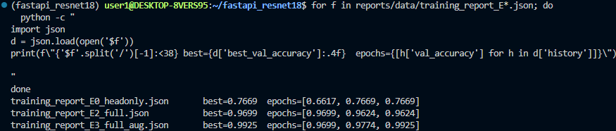

# 산출물 1. ResNet18 콩잎 3클래스 Fine-tuning 결과보고서

| 항목 | 내용 |
|---|---|
| 평가 대상 | 콩잎 이미지 3클래스 분류 (`angular_leaf_spot` / `bean_rust` / `healthy`) |
| 기준 모델 | `microsoft/resnet-18` (ImageNet-1K 사전학습, Apache-2.0) |
| 필수 실험 | **E0 Head-only Fine-tuning** (Backbone 고정, 분류 헤드만 학습) |
| 선택 실험 | **E2 Full Fine-tuning**, **E3 Full Fine-tuning + 이미지 증강** |
| 서비스 선택 모델 | **E3** `artifacts/beans_resnet18_full_aug/` (Validation 기준으로 사전에 정한 규칙에 따라 선택) |
| 학습 데이터 | `dataset/train` 1,034장 / 검증 `dataset/val` 133장 |
| 최종 확인 데이터 | `dataset/test` 128장 (학습·모델 선택에 사용하지 않음, 모델 확정 후 1회 평가) |
| 실행 일시 | 2026-11-04 |

## 0. 한눈에 보는 결과

| ID | 학습 방식 | Best Val Acc | **Test Acc** | Test Macro-F1 | 병든 잎을 healthy로 놓친 수 (Test) |
|---|---|---:|---:|---:|---:|
| E0 | Head-only (필수 기준선) | 0.7669 (102/133) | **0.7188** (92/128) | 0.7109 | 13 |
| E2 | Full Fine-tuning | 0.9699 (129/133) | **0.9531** (122/128) | 0.9533 | 0 |
| **E3** ⭐ | Full Fine-tuning + 증강 | **0.9925** (132/133) | **0.9531** (122/128) | 0.9534 | **0** |

- 기준선(E0) 대비 **Test 정확도 +23.4%p** (0.7188 → 0.9531), **질병→healthy 누락 13장 → 0장**
- 증강(E3)은 Validation에서 E2보다 3장 더 맞혔으나 **Test 정확도는 E2와 동일** → 증강의 정확도 향상 효과는 **확정하지 않음**
- 모델 선택은 **Validation 결과만으로** 했으며, Test는 선택이 끝난 뒤 보고 목적으로만 1회 측정



---

## 1. 실행 환경

| 항목 | 값 | 증빙 |
|---|---|---|
| OS | Windows + WSL2 Ubuntu 22.04.5 LTS (kernel 6.18.54.1-microsoft-standard-WSL2) | `evidence/env_versions.png` |
| Python | 3.11.16 (uv 가상환경 `.venv`) | `evidence/env_python_gpu.png` |
| 주요 라이브러리 | torch / transformers 4.57.6 (정확한 torch 버전 문자열은 증빙 캡처 기준) | `evidence/env_python_gpu.png` |
| 학습 장치 | **GPU: NVIDIA GeForce RTX 3060 12GB** (`torch.cuda.is_available() == True`) | `evidence/env_python_gpu.png` |
| 평가 장치 | CPU (`device=-1`, 서비스 `ai/hf_model.py`와 동일 조건) | 평가 로그 `Device set to use cpu` |
| 시드 | 42 (제공 코드 고정값) | `training/finetune.py` |

- `training/finetune.py`는 `torch.device("cuda" if torch.cuda.is_available() else "cpu")`로 장치를 자동 선택한다. 학습 로그에는 장치명이 출력되지 않으므로, 같은 가상환경에서 CUDA 사용 가능 여부를 별도로 확인해 GPU 학습을 근거로 남겼다.

## 2. 데이터 구성 및 무결성 점검

### 2-1. 클래스별 이미지 수

| 클래스 | Train | Validation | Test |
|---|---:|---:|---:|
| angular_leaf_spot | 345 | 44 | 43 |
| bean_rust | 348 | 45 | 43 |
| healthy | 341 | 44 | 42 |
| **합계** | **1,034** | **133** | **128** |

- 세 클래스 비율이 약 1:1:1 → Accuracy 해석 시 클래스 불균형 영향이 작음
- 원본 기록: `reports/data/dataset_check.json`

### 2-2. 원본 보존 및 실행용 폴더 매핑

| 원본 (보존) | 실행용 (제공 코드가 읽는 경로) |
|---|---|
| `~/beans_source/train.zip` | `dataset/train/` |
| `~/beans_source/validation.zip` | **`dataset/val/`** (제공 코드는 `val` 폴더명을 요구) |
| `~/beans_source/test.zip` | `dataset/test/` |

- 원본 zip은 수정하지 않고 보존 (`evidence/data_source_original.png`)
- 실행용 폴더 구조 확인 (`evidence/data_mapping.png`)

### 2-3. 원본 zip 항목 수와 이미지 수 대조

`unzip -l`의 항목 수가 이미지 수와 달라, 원인을 확인했다.

| zip | 전체 항목 | 이미지 (jpg/jpeg/png/webp) | 차이 원인 |
|---|---:|---:|---|
| train.zip | 1,039 | **1,034** | 폴더 항목 4 + **비이미지 파일 1** |
| validation.zip | 137 | **133** | 폴더 항목 4 |
| test.zip | 132 | **128** | 폴더 항목 4 |

- 비이미지 파일: `train/healthy/healthy_train.120tore`
  - `file` 명령 판정: **Apple Desktop Services Store** (macOS `.DS_Store` 메타데이터, 이미지 아님)
  - 같은 번호의 이미지(`healthy_train.120.jpg`)는 존재하지 않음 → **이 파일로 인해 누락된 이미지는 없음**
  - 제공 학습 코드와 점검 스크립트 모두 확장자 필터(`.jpg/.jpeg/.png/.webp`)로 제외 → 학습 데이터 1,034장은 원본 이미지 수와 일치
  - 증빙: `evidence/data_source_original.png`, `evidence/data_odd_file_check.png`

### 2-4. 중복·누출 점검

- 도구: `scripts/check_dataset.py` (추가 작성, 제공 코드 미수정) — 전체 이미지의 SHA-256 해시 비교
- 결과: **중복 그룹 0 / Split 간 누출 0 / 라벨 충돌 0** (`evidence/data_check_result.png`)
- 한계: 바이트 단위로 완전히 같은 파일만 검출. 같은 잎을 다시 찍은 유사 이미지는 확인하지 못함

---

## 3. 실험 설계

### 3-1. 실험 구성 — 한 번에 한 가지 조건만 바꿈

| ID | 구분 | 바꾼 조건 | 비교 대상 | 확인하려는 것 |
|---|---|---|---|---|
| E0 | 필수 | — (제공 명령 그대로) | — | 기준선 |
| E2 | 선택 | `--freeze-backbone` 제거, lr 0.00005 | E0 | 전체 층 학습 효과 |
| E3 | 선택 | E2와 동일 + **Train 이미지 증강** | E2 | 증강 효과 |

- E2 명령은 평가 가이드 6-1 B의 샘플 실행 옵션과 같다 (epochs 3, batch 8, lr 0.00005).
- 학습률을 낮춘 이유: Full Fine-tuning은 ImageNet으로 이미 학습된 Backbone까지 수정하므로, 큰 학습률은 사전학습 특징을 훼손할 수 있다.

### 3-2. 평가 규칙 (실험 전에 정함)

1. 모델 선택은 **Validation 정확도로만** 한다.
2. E3 vs E2 선택 기준: E3가 E2보다 **2장 이상** 더 맞히면 E3, ±1장 이내면 더 단순한 E2
   (Validation 133장에서 1장 = 0.75%p로 우연과 구분하기 어려움)
3. Test는 **선택이 끝난 뒤 1회만** 측정하고, 결과에 따라 선택을 바꾸지 않는다.

### 3-3. 이미지 증강 설정 (E3)

| 증강 | 설정 | 의도 |
|---|---|---|
| RandomHorizontalFlip | p=0.5 | 촬영 방향이 달라도 병은 같다 |
| RandomRotation | ±20° | 잎 기울기 차이 |
| ColorJitter | brightness=0.2, contrast=0.2 | 햇빛·그늘 등 조명 차이 |
| hue/saturation | **변경하지 않음** | 녹병(적갈색)·반점병(황갈색)은 **색이 핵심 단서** → 색조 변경은 라벨과 맞지 않는 이미지를 만들 위험 |

- 증강은 **Train에만** 적용하고 Validation에는 적용하지 않음
- 구현: `training/finetune_aug.py` — 제공 `training/finetune.py`를 **수정하지 않고** 학습 루프·시드·저장 방식을 그대로 재사용하며, 이미지를 읽는 `FolderImages`만 증강 버전으로 바꿔 끼우는 래퍼

---

## 4. 실행 설정

| 파라미터 | E0 | E2 | E3 |
|---|---|---|---|
| 실행 파일 | `training/finetune.py` | `training/finetune.py` | `training/finetune_aug.py` |
| freeze_backbone | **True** | False | False |
| 학습 파라미터 | 분류 헤드만 (512×3+3 = 1,539개) | 전체 | 전체 |
| epochs | 3 | 3 | 3 |
| batch_size | 8 | 8 | 8 |
| learning_rate | 0.0002 (기본값) | 0.00005 | 0.00005 |
| 증강 | 없음 | 없음 | Train만 적용 |
| 출력 폴더 | `artifacts/beans_resnet18` | `artifacts/beans_resnet18_full` | `artifacts/beans_resnet18_full_aug` |
| 학습 시간 (`time` real) | 28.1초 | 35.1초 | 38.0초 |

- 출력층: 1,000 → **3** (`classifier.1.weight [1000,512] → [3,512]`, `classifier.1.bias [1000] → [3]` 재초기화, 학습 로그 경고로 확인)
- 각 실험은 **별도 폴더**에 저장해 기준선을 덮어쓰지 않음

실행 명령 (제공 옵션만 변경, 로그 저장을 위한 `tee`만 추가):

```bash
# E0 (필수)
time python -u -m training.finetune --data dataset --output artifacts/beans_resnet18 \
  --epochs 3 --batch-size 8 --freeze-backbone 2>&1 | tee reports/evidence/train_headonly.log
# E2 (선택: Full Fine-tuning)
time python -u -m training.finetune --data dataset --output artifacts/beans_resnet18_full \
  --epochs 3 --batch-size 8 --lr 0.00005 2>&1 | tee reports/evidence/train_full_e3.log
# E3 (선택: Full Fine-tuning + 증강)
time python -u -m training.finetune_aug --data dataset --output artifacts/beans_resnet18_full_aug \
  --epochs 3 --batch-size 8 --lr 0.00005 2>&1 | tee reports/evidence/train_full_aug_e3.log
```

---

## 5. 학습 결과 (epoch별)

| Epoch | E0 Loss | E0 Val | E2 Loss | E2 Val | E3 Loss | E3 Val |
|---:|---:|---:|---:|---:|---:|---:|
| 1 | 0.9924 | 0.6617 | 0.4406 | **0.9699** | 0.4582 | 0.9699 |
| 2 | 0.8108 | **0.7669** | 0.1552 | 0.9624 | 0.1843 | 0.9774 |
| 3 | 0.7078 | 0.7669 | 0.0863 | 0.9624 | 0.1444 | **0.9925** |
| **저장된 epoch** | 2 | | 1 | | 3 | |

- 제공 코드는 `acc > best_acc`일 때만 저장 → E0는 epoch 2, E2는 epoch 1, E3는 epoch 3 체크포인트가 저장됨
- 원본 기록: `reports/data/training_report_E0_headonly.json`, `training_report_E2_full.json`, `training_report_E3_full_aug.json`
  (`artifacts/`는 용량 때문에 Git 제외 → `training_report.json`만 `reports/data/`에 복사)
- 학습 로그·터미널: `evidence/train_headonly.log`, `train_full_e3.log`, `train_full_aug_e3.log`, `train_*_terminal.png`

### 학습 곡선 해석

- **E0**: 3 epoch 후에도 Loss 0.71로 높음 → 분류 헤드(1,539개 파라미터)만으로는 학습 데이터도 충분히 맞추지 못한 **과소적합 경향**. ImageNet 특징을 그대로 쓰므로 두 질병의 반점 차이를 구분하기 어려움 (6장 혼동행렬 참고)
- **E2**: Loss는 0.09까지 계속 감소했지만 Val은 epoch 1이 최고 → 학습 데이터에 점점 맞춰지는 경향. 다만 차이가 1장(0.75%p)이라 과적합으로 단정하지 않음
- **E3**: Loss는 E2보다 덜 내려갔지만(0.14) Val은 계속 상승 → 매 epoch 조금씩 달라지는 이미지 때문에 학습 이미지를 외우기 어려워짐(규제 효과)

---

## 6. 모델 선택 (Validation 기준)

| 비교 | 결과 | 사전 규칙 적용 |
|---|---|---|
| E2 vs E0 | 129 vs 102 (+27장) | Full Fine-tuning 효과 확인 |
| **E3 vs E2** | **132 vs 129 (+3장)** | 2장 이상 차이 → **E3 선택** |

→ 서비스 모델로 **E3 `artifacts/beans_resnet18_full_aug`** 선택. 이 시점까지 Test는 한 번도 사용하지 않음.

## 7. 평가 스크립트 검증

Test 측정 전에, 새로 작성한 평가 도구 `scripts/evaluate_split.py`가 학습 로그와 같은 점수를 내는지 Validation으로 먼저 확인했다.

| 모델 | 학습 로그 Best Val | 평가 스크립트 Val (CPU) | 일치 |
|---|---:|---:|:---:|
| E0 | 0.7669 | 102/133 = 0.7669 | ✅ |
| E2 | 0.9699 | 129/133 = 0.9699 | ✅ |
| E3 | 0.9925 | 132/133 = 0.9925 | ✅ |

- 평가 방식: 서비스와 같은 `transformers pipeline("image-classification")`, 정답 = 폴더 라벨
- 증빙: `evidence/eval_val_E0.png`, `eval_val_E2.png`, `eval_val_E3.png`
- 원본: `reports/data/eval_val_*.json`, `eval_val_*_predictions.csv`

---

## 8. 최종 Test 결과 (모델 확정 후 1회)

### 8-1. 정확도 및 클래스별 지표

| 모델 | Accuracy | angular P / R / F1 | bean_rust P / R / F1 | healthy P / R / F1 |
|---|---:|---|---|---|
| E0 | 0.7188 | 0.698 / 0.698 / 0.698 | 0.697 / **0.535** / 0.605 | 0.750 / 0.929 / 0.830 |
| E2 | 0.9531 | 0.915 / 1.000 / 0.956 | 0.951 / 0.907 / 0.929 | 1.000 / 0.952 / 0.976 |
| **E3** | **0.9531** | 0.894 / 0.977 / 0.933 | 0.974 / 0.884 / 0.927 | **1.000 / 1.000 / 1.000** |

### 8-2. 혼동행렬 (행 = 정답, 열 = 예측)

**E0 (Head-only)**

| 정답＼예측 | angular | bean_rust | healthy |
|---|---:|---:|---:|
| angular_leaf_spot (43) | **30** | 7 | 6 |
| bean_rust (43) | 13 | **23** | 7 |
| healthy (42) | 0 | 3 | **39** |

**E3 (Full + 증강, 서비스 모델)**

| 정답＼예측 | angular | bean_rust | healthy |
|---|---:|---:|---:|
| angular_leaf_spot (43) | **42** | 1 | 0 |
| bean_rust (43) | 5 | **38** | 0 |
| healthy (42) | 0 | 0 | **42** |

### 8-3. 오류 유형별 분석 (Test)

| 오류 유형 | 위험도 | E0 | E2 | E3 |
|---|---|---:|---:|---:|
| 질병 → healthy (병을 놓침) | 🔴 높음 (방제 시기 놓침) | **13** | 0 | **0** |
| healthy → 질병 (오경보) | 🟡 중간 (불필요한 확인) | 3 | 2 | **0** |
| 질병 ↔ 질병 (병명 혼동) | 🔵 낮음~중간 | 20 | 4 | 6 |
| **합계** | | 36 | 6 | 6 |

- 증빙: `evidence/eval_test_E0.png`, `eval_test_E2.png`, `eval_test_E3.png`
- 원본: `reports/data/eval_test_*.json`, `eval_test_*_predictions.csv`

---

## 9. 결과 해석

1. **Head-only의 한계와 Full Fine-tuning 효과**
   E0의 오답 36장 중 20장이 두 질병 간 혼동, 13장이 질병→healthy 누락이었다. ImageNet 특징을 고정한 채 분류 헤드만 학습해서는 콩잎 병반의 미세한 색·모양 차이를 표현하기 어려웠다. Backbone까지 학습한 E2·E3에서 이 두 유형이 크게 줄었다.
2. **증강 효과는 확정하지 않음**
   E3는 Validation에서 +3장이었지만 Test 정확도(122/128)와 Macro-F1(0.9533 vs 0.9534)은 E2와 사실상 같다. 시드 1개, 1회 실행 결과이므로 증강이 정확도를 높였다고 주장하지 않는다. 다만 E3는 Test에서 healthy를 오류 없이 구분했다.
3. **Validation이 Test보다 높은 이유**
   Validation은 best epoch 선택과 모델 선택에 모두 사용되어 낙관적으로 추정된다. E3(−3.9%p)는 두 번 선택된 결과라 차이가 가장 크다. 실제 일반화 성능은 Test 0.9531로 보고한다.
4. **남은 과제: 두 질병 구분**
   E3의 Test 오답 6장은 모두 질병 간 혼동이며, 그중 5장이 `bean_rust → angular_leaf_spot`이다. 이후 HSV 색상 분석과 Grad-CAM으로 원인을 분석한다 (산출물 8 개선 제안).
5. **확신을 갖고 틀린 오답 존재**
   E3의 Validation 오답 1장은 1·2위 점수 차(margin) 0.4 이상 구간에서 발생했다. 따라서 "점수가 애매하면 보류" 규칙만으로는 모든 오답을 거를 수 없고, 모델 점수와 독립적인 근거(예: 병반 색 면적비)가 필요하다. 보류 기준은 Test가 아닌 Validation으로만 설계해야 하며, E3는 Validation의 저신뢰 구간에 오답이 없어 기준을 정할 근거가 부족하다.

---

## 10. 생성 파일 확인 (E3 기준, E0·E2 동일 구성)

- [x] `config.json` (id2label: angular_leaf_spot / bean_rust / healthy)
- [x] `model.safetensors`
- [x] `preprocessor_config.json`
- [x] `training_report.json` (E3는 `experiment` 항목에 증강·lr·epoch 설정 추가 기록)

증빙: `evidence/train_artifacts.png`, `evidence/train_report_json.png`

## 11. 서비스 연결 확인

### 11-1. 원본 → E0 (01 단계, 동기 API)

`.env`의 `MODEL_PATH`를 `microsoft/resnet-18` → `artifacts/beans_resnet18`로 변경 후 같은 이미지로 비교

| 정답 | 원본 모델 top1 (score) | E0 top1 (score) | 판정 |
|---|---|---|---|
| angular_leaf_spot | green mamba (0.318) | angular_leaf_spot (0.462) | 정답 |
| bean_rust | cucumber (0.307) | bean_rust (0.605) | 정답 |
| healthy | bonnet (0.703) | healthy (0.637) | 정답 |

- 응답 `model_id`가 `artifacts/beans_resnet18`로 바뀐 것을 확인 (`evidence/api_sync_before_*.png`, `api_sync_after_*.png`)
- 3장 결과는 서비스 연결 시연이며 정확도 지표가 아님

### 11-2. E0 → E3 서비스 모델 교체 (02 단계, Docker Compose)

> **[교체 후 기입]** `.env` `MODEL_PATH=artifacts/beans_resnet18_full_aug` → `docker compose up -d --force-recreate web worker` → 동기·비동기 응답의 `model_id` 확인

## 12. 결과 판정

- **완료**
  - 필수: Head-only Fine-tuning 학습·저장·서비스 연결 (E0)
  - 선택: Full Fine-tuning(E2), Full Fine-tuning + 증강(E3) 실측 비교
  - 별도 평가 도구로 Validation 재현 확인 후 Test 1회 측정
- **한계**
  - 각 실험 1회 실행(시드 42), 결과의 변동 폭은 미확인
  - Test 128장은 1장이 0.78%p → 작은 차이는 우연일 수 있음
  - 데이터는 같은 출처(Makerere beans)이며, 다른 조명·카메라·지역의 현장 사진에서의 성능은 미검증
  - 학습 범위 밖 이미지(예: 고양이 사진)도 3클래스 중 하나로 분류함 (`evidence/web_sync_non_leaf_cat.png`, bean_rust 0.525)
  - score는 보정된 확률이 아님
  - 중복 점검은 완전 일치만 확인 (유사 이미지 누출 미확인)

## 13. 증빙 목록

| 구분 | 파일 |
|---|---|
| 환경 | `evidence/env_versions.png`, `evidence/env_python_gpu.png` |
| 데이터 | `evidence/data_source_original.png`, `data_mapping.png`, `data_odd_file_check.png`, `data_check_result.png` |
| 학습 | `evidence/train_headonly_terminal.png`, `train_headonly_time.png`, `train_full_e3_terminal.png`, `train_full_aug_e3_terminal.png`, `experiments_val_compare.png`, `train_report_json.png`, `train_artifacts.png` |
| 평가 | `evidence/eval_val_E0.png`, `eval_val_E2.png`, `eval_val_E3.png`, `eval_test_E0.png`, `eval_test_E2.png`, `eval_test_E3.png` |
| 서비스 연결 | `evidence/api_sync_before_*.png`, `api_sync_after_*.png` |
| 원본 데이터 | `reports/data/dataset_check.json`, `training_report_E*.json`, `eval_*.json`, `eval_*_predictions.csv` |
| 추가 도구 | `scripts/check_dataset.py`, `scripts/evaluate_split.py`, `training/finetune_aug.py` (제공 코드 미수정) |
