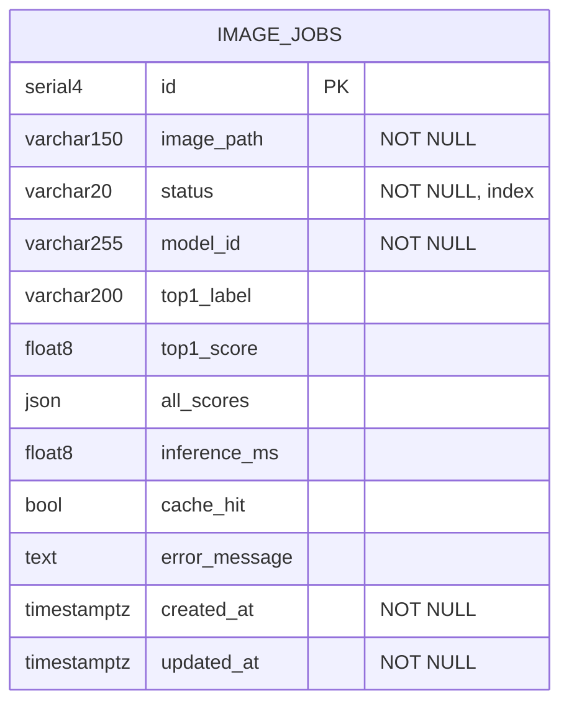
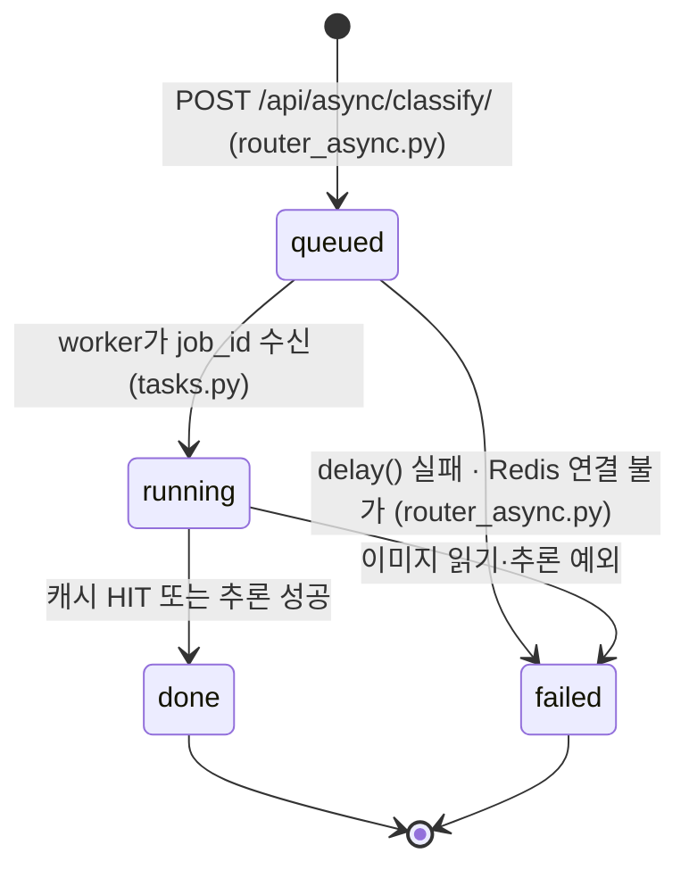

# 산출물 4. 데이터베이스 구조 및 작업이력

- DB: PostgreSQL 17 (`vision_db`, 사용자 `vision_user`), Docker Compose `postgres` 서비스
- 테이블: **`image_jobs` 1개** · PK `id` · 저장 대상: **비동기 작업**의 상태와 결과
- 테이블 생성: 서버 시작 시 `main.py` lifespan → `ai/database.py` `init_db()` → SQLAlchemy `create_all`
- 조회 도구: DBeaver 26.2.4 (`localhost:5432`), `psql`

## 1. 테이블 정의 (ERD)



- 테이블이 하나이므로 FK·관계 테이블은 없다 (`evidence/06_db/db_erd.png`).

### 실제 DDL (DBeaver에서 추출)

```sql
CREATE TABLE public.image_jobs (
    id serial4 NOT NULL,
    image_path varchar(150) NOT NULL,
    status varchar(20) NOT NULL,
    model_id varchar(255) NOT NULL,
    top1_label varchar(200) NULL,
    top1_score float8 NULL,
    all_scores json NULL,
    inference_ms float8 NULL,
    cache_hit bool NULL,
    error_message text NULL,
    created_at timestamptz NOT NULL,
    updated_at timestamptz NOT NULL,
    CONSTRAINT image_jobs_pkey PRIMARY KEY (id)
);
CREATE INDEX ix_image_jobs_status ON public.image_jobs USING btree (status);
```
증빙: `evidence/06_db/db_ddl.png`, `evidence/06_db/db_schema.png`

## 2. 컬럼 설명 (`ai/models.py` 대응)

| 컬럼 | DB 자료형 | Null / 기본 | 실제 값 예시 | 사용 이유 |
|---|---|---|---|---|
| id | serial4 | PK, 자동 증가 | 8 | 작업 번호 = API `job_id` |
| image_path | varchar(150) | NOT NULL | `65673c08e4c94ddbb60f492729647490.bin` | `media/jobs/` 안의 파일 이름 (`uuid4().hex`, 사용자 파일명 미사용) |
| status | varchar(20) | NOT NULL, 기본 `queued`, **인덱스** | `done` | 상태 전이 추적, 상태별 조회 |
| model_id | varchar(255) | NOT NULL | `artifacts/beans_resnet18_full_aug` | 어떤 모델이 판정했는지 추적 |
| top1_label | varchar(200) | NULL | `bean_rust` | 최종 분류 라벨 |
| top1_score | float8 | NULL | 0.4314 | 분류 점수 (보정된 확률 아님) |
| all_scores | json | NULL | `[{"label":"bean_rust","score":0.43}, ...]` | 클래스별 점수 전체 (API 응답에서는 `all`) |
| inference_ms | float8 | NULL | 22.18 / NULL | 추론 시간, **캐시 HIT면 NULL** |
| cache_hit | bool | NULL | true / false | 캐시 재사용 여부 (queued 상태에서는 NULL) |
| error_message | text | NULL | `작업 큐 등록 실패: Redis 연결을 확인하세요.` | 실패 원인 (최대 1,500자) |
| created_at | timestamptz | NOT NULL, UTC 현재 | `2026-11-04 12:21:33.152+09` | 접수 시각 |
| updated_at | timestamptz | NOT NULL, 갱신 시 자동 | `2026-11-04 12:23:49.617+09` | 마지막 상태 변경 시각 |

- 파이썬에서 `Mapped[str]`(Optional 아님)로 선언한 컬럼이 DB에서 `NOT NULL`이 되었다.
- 시각은 UTC로 저장되고 DBeaver가 `+09` 한국 시간으로 표시한다 (컨테이너 로그는 UTC).
- **이미지 원본은 DB에 저장하지 않는다** → `media/jobs/*.bin` (`evidence/06_db/media_jobs_files.png`)
- **동기 요청은 DB 행을 만들지 않는다** (기본 제공 코드 설계)

## 3. 상태 전이



- `running`은 처리가 빠르면(warm 추론 약 20ms) 조회 시점에 거의 보이지 않는다. 정상 완료 여부는 최종 상태·DB·worker 로그로 판단했다.
- `failed`는 **자동 재처리되지 않는다** (Redis 복구 후에도 job 20은 `failed` 유지).

## 4. 실제 작업 이력 (2026-11-04)

```sql
SELECT id, status, model_id, top1_label, cache_hit, inference_ms, error_message,
       updated_at - created_at AS elapsed
FROM image_jobs ORDER BY id;
```

| id | status | model | top1 | cache_hit | inference_ms | 처리 | 무엇을 확인했나 |
|---:|---|---|---|---|---:|---|---|
| 1 | done | E1 | healthy | **t** | — | 0.05초 | 동기 요청이 만든 캐시를 **worker가 재사용** |
| 2 | done | E1 | bean_rust | f | 2254.13 | 2.28초 | worker **첫 추론 (cold)** |
| 3 | done | E1 | healthy | f | 2352.83 | **2분 16초** | **worker 정지 중 접수** → 재시작 후 처리 (큐 보존) |
| 4 | done | E1 | bean_rust | f | 22.18 | 0.04초 | warm 추론 (웹 화면) |
| 5 | done | E1 | bean_rust | **t** | — | 0.01초 | 같은 이미지 재요청 → HIT |
| 6 | done | E1 | angular_leaf_spot | f | 2826.38 | — | 브로커 대기열 테스트 (`LLEN 1 → 0`) |
| 7 | done | E1 | angular_leaf_spot | f | 19.41 | — | 웹 화면 polling 로그 |
| 8 | done | **E3** | bean_rust | t | — | — | **모델 교체 후 첫 비동기** (동기 캐시 재사용) |
| 9 | done | E3 | (미조회) | f | 2771.32 | 2.94초¹ | 성능 측정 워밍업 (비교 제외) |
| 10~19 | done | E3 | (미조회) | f×5 / t×5 | 19.07~20.76 / — | — | 성능 측정 비동기 MISS·HIT 각 5회 (`timings.csv`) |
| **20** | **failed** | E3 | — | — | — | — | **Redis 중지 중 접수** → `작업 큐 등록 실패: Redis 연결을 확인하세요.` |
| 21 | done | E3 | healthy | f | (미조회) | — | **Redis 복구 후** 정상 처리 (장애 중 캐시 저장 실패로 MISS) |

- ¹ job 9의 2.94초는 측정 스크립트가 잰 접수~done 확인 시간이다 (DB 계산값 아님).
- 처리 시간(`updated_at − created_at`)은 job 1~5만 DBeaver로 계산했다 (`evidence/06_db/dbeaver_image_jobs_elapsed.png`).
- job 9~19의 값은 `reports/data/timings.csv`·`timings_warmup.csv`에 원본이 있다.
- job 6의 이미지는 `bean_rust_test.20.jpg`로, E1가 **angular_leaf_spot으로 오분류**한 사례다 (E1의 질병 간 혼동).

### 조회 화면

| 장면 | 증빙 |
|---|---|
| 첫 비동기 HIT·MISS 2행 | `evidence/06_db/db_image_jobs_hit_miss.png` |
| DBeaver 전체 컬럼 (job 1~5) | `evidence/06_db/dbeaver_image_jobs.png` |
| 처리 시간 계산 쿼리 (job 3 = 2분 16초) | `evidence/06_db/dbeaver_image_jobs_elapsed.png` |
| E1 → E3 교체 이력 (job 7 / job 8) | `evidence/05_web_api/model_switch_E3_api_db.png` |
| **failed 행** (job 20) | `evidence/08_failure_test/redis_down_db_failed.png` |
| 복구 후 done (job 21) | `evidence/08_failure_test/redis_recovered.png` |

## 5. 기록에서 얻은 결론

1. **DB 기록이 장애 분석의 근거가 된다.** job 3의 2분 16초는 worker 정지 시간, job 20의 메시지는 Redis 장애 시점을 그대로 보여 준다.
2. **`model_id`를 행마다 저장한 덕분에** 모델 교체 시점(job 7 → 8)이 남는다. 모델 버전을 바꿔도 과거 판정이 어떤 모델의 결과인지 추적할 수 있다.
3. **한계:** `queued → running → done` 각 단계의 시각이 따로 없어 대기 시간과 처리 시간을 분리할 수 없다 → `started_at`, `finished_at` 컬럼 추가를 개선안으로 제안 ([산출물 8](08_최종기술보고서.md)).
