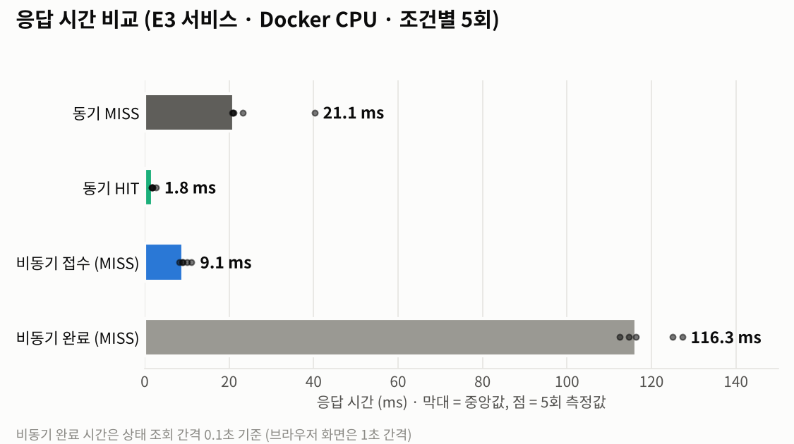

# 산출물 6. 성능 측정 및 비교 보고서

- 측정 대상: 서비스 응답 시간 (동기 / 비동기 × 캐시 MISS / HIT)
- 원본 데이터: [`reports/data/timings.csv`](data/timings.csv) · [`timings_warmup.csv`](data/timings_warmup.csv) · [`timings_summary.json`](data/timings_summary.json)
- 측정 도구: `scripts/measure_timings.py` (추가 작성, 서버에 HTTP 요청만 보냄 · 제공 코드 미수정)
- 모델 정확도 비교는 [산출물 1](01_FineTuning_결과보고서.md)에 있다. **응답 시간과 정확도는 서로 다른 지표**이므로 섞어 해석하지 않는다.



## 1. 실험 조건

| 조건 | 값 |
|---|---|
| 모델 | `artifacts/beans_resnet18_full_aug` (E3, 서비스 모델) |
| 실행 환경 | Docker Compose: web(Uvicorn 1개) · worker(Celery solo, concurrency 1) · Redis 7.4 · PostgreSQL 17, **추론 CPU** |
| 호스트 | Windows + WSL2 Ubuntu 22.04.5, 측정 클라이언트도 같은 PC (`127.0.0.1`) |
| 이미지 | `dataset/test`에서 클래스를 번갈아 고른 **서로 다른 이미지** (동기용 5장, 비동기용 5장, 워밍업 2장) |
| 반복 | 조건별 **5회** |
| 캐시 | MISS = 처음 보내는 이미지 / HIT = 방금 MISS로 보낸 **같은 이미지**를 바로 재전송 (TTL 600초 안) |
| 캐시 판정 | 기대값이 아니라 **응답의 실제 `cache_hit`**로 기록 → 20회 모두 기대와 일치 (경고 0건) |
| 워밍업 | web·worker 각 1회 먼저 요청하고 **비교에서 제외** (`timings_warmup.csv`에 따로 저장) |
| 동기 시간 | `http_ms` = POST 응답까지 = 결과 확인 시간 |
| 비동기 시간 | `http_ms` = 202 접수 응답까지 / `final_ms` = POST 시작 \~ 조회 결과가 `done`이 될 때까지 |
| 비동기 조회 간격 | **0.1초** (브라우저 화면은 1초 → 화면 체감은 약 1초) |
| 측정 시각 | 2026-11-04 15:36 |

## 2. 원본 측정표 (단위 ms)

| 반복 | 동기 MISS | 동기 HIT | 비동기 접수 MISS | 비동기 완료 MISS | 비동기 접수 HIT | 비동기 완료 HIT |
|---:|---:|---:|---:|---:|---:|---:|
| 1 | 40.23 | 2.68 | 10.01 | 116.35 | 10.11 | 127.64 |
| 2 | 21.09 | 1.90 | 8.24 | 112.43 | 11.63 | 127.84 |
| 3 | 20.78 | 1.64 | 8.83 | 114.68 | 8.06 | 128.62 |
| 4 | 23.32 | 1.84 | 9.12 | 125.06 | 10.86 | 120.82 |
| 5 | 20.97 | 1.63 | 11.11 | 127.29 | 7.97 | 125.87 |
| **중앙값** | **21.09** | **1.84** | **9.12** | **116.35** | **10.11** | **127.64** |

| 경로 | 캐시 | 추론 시간 중앙값 (`inference_ms`) | 비고 |
|---|---|---:|---|
| 동기 | MISS | 16.18 | 5회: 26.38 / 16.18 / 15.62 / 17.94 / 15.51 |
| 동기 | HIT | — (null) | 추론 생략 |
| 비동기 | MISS | 20.34 | 5회: 19.46 / 19.07 / 20.34 / 20.76 / 20.69 |
| 비동기 | HIT | — (null) | 추론 생략 |

워밍업 (비교 제외)

| 경로 | http_ms | final_ms | inference_ms | 의미 |
|---|---:|---:|---:|---|
| 동기 | 41.32 | 41.32 | 31.38 | web은 모델 교체 확인 요청 때 이미 로드됨 |
| 비동기 | 21.79 | **2,940.79** | **2,771.32** | worker는 여기서 **처음 모델 로드** (교체 직후 비동기 job 8은 캐시 HIT라 로드가 없었음) |

→ 워밍업을 분리하지 않았다면 비동기 MISS 결과에 약 2.9초짜리 로딩 시간이 섞였을 것이다.

## 3. 계산

```text
캐시 효과 (동기)       = (21.09 − 1.84) / 21.09 × 100 = 91.3% 단축 (약 11.5배)
HTTP 응답 감소율       = (21.09 − 9.12) / 21.09 × 100 = 56.8%   (비동기 접수 vs 동기 MISS)
결과 확인 시간 차이     = 116.35 − 21.09 = 95.26 ms          (비동기가 더 느림)
동기 MISS의 추론 외 시간 = 21.09 − 16.18 = 4.91 ms            (업로드·검증·캐시 조회/저장·직렬화)
```

## 4. 캐시 비교표

| 경로 | 캐시 | HTTP 응답 (중앙값) | 결과 확인 (중앙값) | 추론 | 메모 |
|---|---|---:|---:|---:|---|
| 동기 | MISS | 21.09 | 21.09 | 16.18 | 모델 실제 추론 |
| 동기 | HIT | **1.84** | **1.84** | — | Redis에서 꺼내기만 함 |
| 비동기 | MISS | 9.12 (접수) | 116.35 | 20.34 | worker 추론 |
| 비동기 | HIT | 10.11 (접수) | 127.64 | — | worker가 캐시 재사용 |

## 5. 해석

1. **캐시는 동기 응답을 91% 줄였다.** 같은 사진이 반복되는 환경(재촬영, 새로고침, 같은 사진 공유)에서 효과가 크다.
2. **비동기는 "접수"가 56.8% 빠를 뿐, 결과는 더 늦게 확인된다.** 비동기 결과 확인(116.35ms)은 동기(21.09ms)보다 95ms 느리다. 이 수치는 **모델 추론이 빨라졌다는 뜻이 아니며**, 접수와 처리를 분리한 효과다.
3. **비동기 MISS와 HIT의 완료 시간(116 vs 128ms)은 구분되지 않는다.** 조회 간격이 0.1초라 100ms 미만의 차이는 측정 해상도 밖이다. 추론(약 20ms)이 조회 간격 안에 숨는다.
4. **ResNet-18은 CPU로도 충분히 빠르다.** warm 추론은 컨테이너 CPU에서 15.5\~26.4ms로, 01 단계 WSL 실행(21\~26ms, 아래 7장)과 비슷한 수준이다.
5. **첫 요청(cold)은 수 초가 걸린다.** 모델이 `@lru_cache`로 첫 요청 때 로드되고, `services.py`의 타이머가 `get_classifier()` 호출 전에 시작하므로 로딩 시간이 `inference_ms`에 포함된다.

| cold 사례 | inference_ms | 근거 |
|---|---:|---|
| 01 · WSL · 원본 모델 최초 (HF 다운로드 포함) | 8,653.4 | 7장 #1 |
| 02 · web 컨테이너 · E1 첫 요청 | 2,215.62 | 산출물 3 |
| 02 · worker 컨테이너 · E1 첫 작업 (job 2) | 2,254.13 | 산출물 4 |
| 02 · worker 재시작 후 (job 3) | 2,352.83 | 산출물 4 |
| 02 · web · **E3 교체 직후** | 2,990.65 | `evidence/05_web_api/model_switch_E3_api_db.png` |
| 02 · worker · E3 워밍업 | 2,771.32 | `timings_warmup.csv` |

## 6. 장애 상황의 응답 시간 (Redis 중지, 1회 측정)

| 경로 | 평소 (중앙값) | Redis 중지 중 | 결과 |
|---|---:|---:|---|
| 동기 | 21.09 ms | **8,057 ms** (`inference_ms` 28.29) | 200 · 캐시 없이 추론 |
| 비동기 접수 | 9.12 ms | **20,672 ms** | 503 · `failed` 기록 |

- 코드의 Redis 연결 제한 시간은 1초(`socket_connect_timeout=1`)지만 실제 지연은 훨씬 길었다.
- worker 로그 `Error -5 connecting to redis:6379. No address associated with hostname`으로 **Redis 컨테이너가 꺼지면서 Docker 내부 DNS에서 `redis` 이름 조회가 실패**한 것을 확인했다. 이름 조회 단계는 연결 제한 시간 밖에서 지연된 것으로 판단한다(추정, 정밀 계측은 미실시).
- 비동기 503까지 20초가 걸린 것은 Celery의 발행 재시도가 이 지연과 겹친 결과로 보인다(추정).
- 개선안: Redis 장애를 감지하면 일정 시간 캐시를 건너뛰는 **서킷 브레이커**, Celery 발행 재시도·브로커 연결 시간 제한 단축 ([산출물 8](08_최종기술보고서.md))

증빙: `evidence/08_failure_test/redis_down_sync_200.png`, `redis_down_async_503.png`, `redis_down_worker_log.png`

## 7. 참고: 01 단계 cold/warm 측정 (WSL, 캐시 없음)

측정 환경: WSL2 Ubuntu-22.04 / Python 3.11 / 서버 추론 CPU(`device=-1`) / 01 동기 API

| # | 모델 | 상태 | 이미지 | inference_ms | 비고 |
|---:|---|---|---|---:|---|
| 1 | 원본 resnet-18 | Cold (최초) | angular_leaf_spot_test.10.jpg | 8653.4 | Hugging Face 다운로드 + 로딩 포함 |
| 2 | 원본 resnet-18 | Cold (재시작) | angular_leaf_spot_test.0.jpg | 4651.67 | 로컬 캐시에서 로딩 |
| 3 | 원본 resnet-18 | Warm | bean_rust_test.0.jpg | 26.27 | |
| 4 | 원본 resnet-18 | Warm | healthy_test.0.jpg | 21.2 | |
| 5 | beans_resnet18 (E1) | Cold (재시작) | angular_leaf_spot_test.0.jpg | 2419.73 | 로컬 폴더에서 로딩 |
| 6 | beans_resnet18 (E1) | Warm | bean_rust_test.0.jpg | 23.76 | |
| 7 | beans_resnet18 (E1) | Warm | healthy_test.0.jpg | 21.74 | |
| 8 | beans_resnet18 (E1) | Cold (재시작, curl) | healthy_test.16.jpg | 4000.74 | |
| 9 | beans_resnet18 (E1) | Warm (curl, 같은 이미지) | healthy_test.16.jpg | 21.33 | #8과 score 동일 (0.70336) |

- 원본 모델과 학습 모델의 warm 추론 시간은 거의 같다 (Backbone 동일, 출력층만 1000→3).
- 증빙: `evidence/04_sync_api_01/server_first_request_log.png`, `evidence/04_sync_api_01/api_sync_curl_cold_warm.png`

### 참고: 웹 화면 1회 측정 (E1, 브라우저 `performance.now()`)

| 장면 | 화면 표시 | 증빙 |
|---|---|---|
| 동기 MISS → HIT | 37ms → 10ms | `evidence/05_web_api/web_sync_miss.png`, `web_sync_hit.png` |
| 비동기 | 접수 19ms / 전체 1042ms (조회 간격 1초) | `evidence/05_web_api/web_async_2_done.png` |

## 8. 비교 조건 점검

- [x] 같은 모델 체크포인트(E3)로 측정
- [x] MISS 대 MISS, HIT 대 HIT 구분 (실제 응답의 `cache_hit`로 판정)
- [x] 같은 하드웨어·같은 서버 상태에서 연속 측정
- [x] 모델 첫 로딩(워밍업) 분리 및 별도 기록
- [x] 반복 원본값(`timings.csv`)과 요약표(`timings_summary.json`) 일치
- [x] 비동기 완료 시간에 조회 간격 포함 여부 표기 (0.1초)
- [ ] 동시 요청(부하) 상황 측정 — **미실시** (단일 사용자 순차 요청만 측정)

## 9. 한계

- 조건별 5회로 표본이 작다. 동기 MISS 1회차(40.23ms)처럼 튀는 값이 있어 평균 대신 **중앙값**을 썼다.
- 이미지마다 크기가 달라 업로드·디코딩 시간이 조금씩 다르다 (MISS/HIT는 같은 이미지끼리 비교했으므로 캐시 효과 비교에는 영향 없음).
- 측정 클라이언트와 서버가 같은 PC라 네트워크 지연이 거의 없다. 실제 원격 환경에서는 모든 값에 네트워크 왕복 시간이 더해진다.
