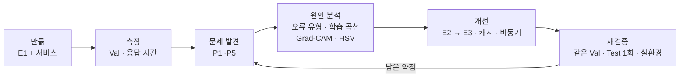
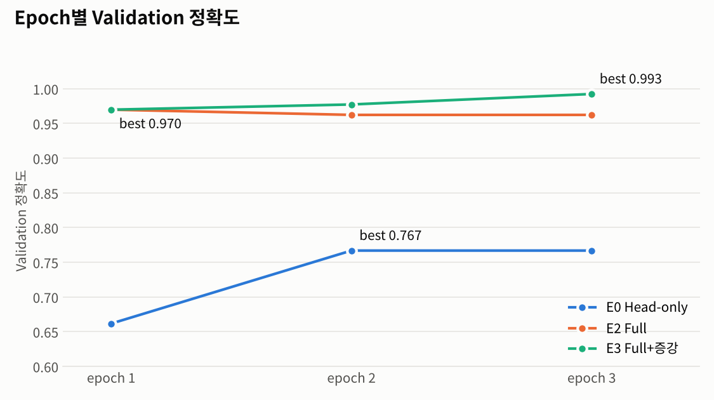
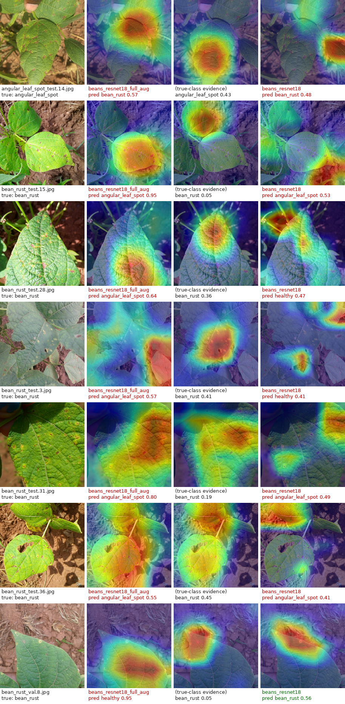
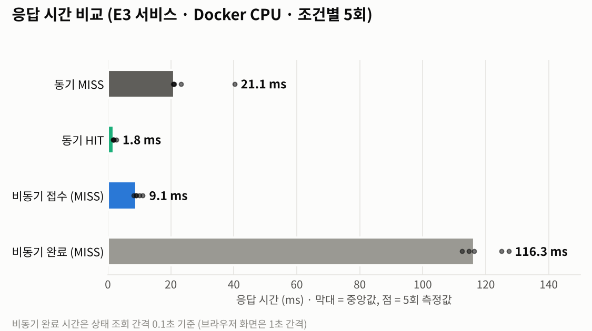

# 산출물 9 (추가). 성능 분석 · 개선 보고서 — 무엇이 약했고, 어떻게 고쳤나

> 작성일 2026-11-04 · 범위: 산출물 1\~8의 실제 결과를 다시 분석해 **문제 → 원인 → 개선 → 재검증** 순서로 정리
> 근거 데이터: `reports/data/` (학습 리포트·평가 JSON·`timings.csv`·HSV 분석) · 실행 캡처: `reports/evidence/`

## 요약

| ID | 문제 | 원인 | 개선 · 조치 | 결과 | 상태 |
|---|---|---|---|---|---|
| P1 | 기준선 정확도 낮음 (Val 0.767) | Backbone 고정 → 병반 특징을 못 배움, Loss가 아직 높음 (과소적합) | **E2** Full Fine-tuning | Val **0.970**, 오답 31 → 4장 | 구현 · 실측 |
| P2 | E2가 epoch 1 이후 Val 정체 | 학습 사진에 맞춰지는 경향 (Loss 0.09) | **E3** Train 이미지 증강 | Val **0.993**, epoch마다 상승 | 구현 · 실측 |
| P3 | 최종 Test 오답 6장 모두 녹병 ↔ 반점병 | 작은 녹병 돌기가 224×224에서 약해짐, 색만으로 구분 불가 | Grad-CAM · OpenCV HSV 분석, 색 규칙 시뮬레이션 | 원인 확인, **색 규칙 기각** | 분석 |
| P4 | 서비스 지연 (반복 요청 · 첫 요청 · 장애) | 같은 사진도 매번 추론, 모델 지연 로딩, Redis 연결 대기 | Redis 캐시 · Celery 비동기 측정, 장애 재현 | 캐시 HIT **−91%**, 장애 시 8초·20초 지연 확인 | 실측 · 일부 제안 |
| P5 | 학습 범위 밖 사진도 3클래스로 답함 | 3클래스 강제 선택, 촬영 조건 차이 | 웹 화면으로 재현·관찰 | 점수 차 0.003 같은 애매한 답 확인 | 관찰 · 제안 |



**실험 원칙**

- 모든 실험은 같은 Train 1,034장 / Validation 133장, epochs 3, batch 8, 제공 `training/finetune.py` 미수정
- 모델 비교·선택은 **Validation**으로 하고, 학습 전에 정한 규칙(E3가 E2보다 2장 이상 더 맞혀야 채택)을 따름
- 최종 성능은 선택된 E3의 Test 128장 결과. Test 결과로 기준이나 규칙을 바꾸지 않음

---

## 1. 출발점 — 제공 코드 그대로 (E1)

```bash
python -m training.finetune --data dataset --output artifacts/beans_resnet18 \
  --epochs 3 --batch-size 8 --freeze-backbone          # lr 기본값 0.0002
```

| Epoch | Train Loss | Val Accuracy |
|---:|---:|---:|
| 1 | 0.9924 | 0.6617 |
| 2 | 0.8108 | **0.7669** |
| 3 | 0.7078 | 0.7669 |

- 학습 대상은 마지막 분류 헤드 **1,539개**뿐이고, Backbone(약 1,118만 개)은 ImageNet 가중치로 고정됐다.
- 3클래스를 무작위로 찍을 때의 Loss는 ln 3 ≈ 1.10이다. E1는 3 epoch 뒤에도 **0.71**로 아직 높아, 학습 데이터조차 충분히 맞히지 못하는 상태였다.

| 클래스 (Val) | Precision | Recall | F1 |
|---|---:|---:|---:|
| angular_leaf_spot (반점병) | 0.7857 | 0.7500 | 0.7674 |
| bean_rust (녹병) | 0.7250 | **0.6444** | 0.6824 |
| healthy (정상) | 0.7843 | 0.9091 | 0.8421 |

| 오류 유형 (Val 오답 31장) | 장수 | 의미 |
|---|---:|---|
| 질병 → healthy (병을 놓침) | **11** | 가장 위험: 병든 잎을 정상으로 판정 |
| healthy → 질병 (오경보) | 4 | 불필요한 확인 작업 |
| 질병 ↔ 질병 (병명 혼동) | 16 | 반점병과 녹병을 서로 헷갈림 |

- 1·2위 점수 차가 0.4 미만인 사진이 133장 중 92장이었다. 모델이 대부분의 사진에서 **확신 없이** 답했다.

---

## 2. P1 · 정확도가 낮다 → Backbone까지 학습 (E2)

### 원인 분석

| 근거 | 해석 |
|---|---|
| Loss 0.71에서 멈춤 | 고정된 특징 위에 분류 헤드만으로는 표현력이 부족하다 |
| 오답 대부분이 병반 구분 실패 (놓침 11 + 혼동 16) | ImageNet 특징은 "사물"용이라 작은 병반의 색·모양 차이를 담지 못한다 |
| healthy Recall 0.91 vs 녹병 0.64 | 녹병의 작은 돌기 같은 미세한 특징일수록 더 못 잡는다 |

### 개선

```bash
python -m training.finetune --data dataset --output artifacts/beans_resnet18_full \
  --epochs 3 --batch-size 8 --lr 0.00005               # --freeze-backbone 제거
```

- `--freeze-backbone`을 빼면 제공 코드가 모든 층의 `requires_grad`를 그대로 두어, **Backbone의 합성곱 층까지 콩잎으로 다시 학습**한다.
- 이미 잘 학습된 가중치를 크게 흔들지 않도록 학습률을 기본값의 ¼로 낮췄다 (평가 가이드 6-1 B 설정).
- 동결 해제와 학습률을 함께 바꿨으므로 두 효과를 분리하지 않고 "Full Fine-tuning 설정"의 효과로 본다.

### 결과

| 지표 (Validation 133장) | E1 | E2 | 변화 |
|---|---:|---:|---:|
| 정확도 | 0.7669 (102) | **0.9699 (129)** | **+20.30%p** |
| 오답 | 31 | 4 | −27장 |
| 병을 놓침 | 11 | 2 | −9장 |
| 녹병 Recall | 0.6444 | 0.9778 | +33.3%p |
| 점수 차 0.4 이상인 사진 | 41장 | 125장 | 확신 있는 답이 대부분이 됨 |

---

## 3. P2 · 과적합 신호 → Train 이미지 증강 (E3)

### 원인 분석

| Epoch | E2 Loss | E2 Val | E3 Loss | E3 Val |
|---:|---:|---:|---:|---:|
| 1 | 0.4406 | **0.9699** | 0.4582 | 0.9699 |
| 2 | 0.1552 | 0.9624 | 0.1843 | 0.9774 |
| 3 | 0.0863 | 0.9624 | 0.1444 | **0.9925** |



- E2는 Loss가 0.44 → 0.09로 계속 내려갔지만 Val은 **epoch 1이 최고**였고 이후 1장 줄었다. 같은 1,034장을 반복해서 보면서 학습 사진에만 맞춰지는 경향으로 해석했다.
- 제공 코드에는 증강이 없어서, 매 epoch 완전히 같은 사진을 본다.

### 개선

| 증강 | 설정 | 의도 |
|---|---|---|
| RandomHorizontalFlip | p = 0.5 | 촬영 방향이 달라도 병은 같다 |
| RandomRotation | ±20° | 잎 기울기 차이 |
| ColorJitter | 밝기 0.2 · 대비 0.2 | 햇빛·그늘 같은 조명 차이 |
| 색조(hue) · 채도 | **변경 안 함** | 녹병(적갈색)과 반점병(황갈색)은 색이 핵심 단서 |

```bash
python -m training.finetune_aug --data dataset --output artifacts/beans_resnet18_full_aug \
  --epochs 3 --batch-size 8 --lr 0.00005
```

- `training/finetune_aug.py`는 제공 `finetune.py`의 학습 루프를 그대로 쓰고, 사진을 읽는 `FolderImages`만 증강 버전으로 바꿔 끼운다. **Train에만** 적용한다.
- E2와 비교해 **증강 하나만** 바꿨다.

### 결과

- E3의 Val은 epoch마다 올라 **0.9925 (132/133)**. Loss는 0.14로 E2보다 덜 내려갔다. 학습 사진을 외우기 어렵게 만든 효과로 해석한다.
- E2보다 3장 더 맞혀 사전 규칙(2장 이상)을 충족 → **E3를 서비스 모델로 선택**.
- Val 오답은 1장(`bean_rust_val.8` → healthy)이고, 오경보와 병명 혼동은 0장.

---

## 4. 최종 평가 — 선택된 E3, Test 128장

| 지표 | 값 |
|---|---|
| 정확도 | **0.9531 (122/128)** |
| Macro-F1 | 0.9534 |
| 병을 놓침 / 오경보 | **0 / 0** |
| 남은 오답 | 6장, 모두 질병 ↔ 질병 혼동 |

| 클래스 (Test) | 정답 수 | Precision | Recall | F1 |
|---|---:|---:|---:|---:|
| angular_leaf_spot | 43 | 0.8936 | 0.9767 | 0.9333 |
| bean_rust | 43 | 0.9744 | **0.8837** | 0.9268 |
| healthy | 42 | 1.0000 | 1.0000 | 1.0000 |

| 정답 \ 예측 | 반점병 | 녹병 | 정상 |
|---|---:|---:|---:|
| 반점병 | 42 | 1 | 0 |
| 녹병 | **5** | 38 | 0 |
| 정상 | 0 | 0 | 42 |

- Val 0.9925 → Test 0.9531 (−3.94%p). Val은 best epoch와 모델 선택에 모두 쓰여 낙관적이므로 예상된 차이다.
- 정상 잎은 한 장도 틀리지 않았고, **녹병을 반점병으로 판정**하는 것이 남은 약점이다 (녹병 Recall 0.88).

---

## 5. P3 · 남은 오답의 원인 — 녹병 ↔ 반점병 혼동

| 오답 (Test) | 정답 → 예측 | 1·2위 점수 차 |
|---|---|---:|
| `angular_leaf_spot_test.14` | 반점병 → 녹병 | 0.142 |
| `bean_rust_test.15` | 녹병 → 반점병 | **0.902** |
| `bean_rust_test.28` | 녹병 → 반점병 | 0.278 |
| `bean_rust_test.3` | 녹병 → 반점병 | 0.161 |
| `bean_rust_test.31` | 녹병 → 반점병 | 0.610 |
| `bean_rust_test.36` | 녹병 → 반점병 | 0.101 |

### ① Grad-CAM — 모델은 어디를 봤나



- E3의 근거는 오답 사진 대부분에서 **잎 영역**에 있었다. 배경을 보고 틀린 것이 아니라, **잎을 보고도 병반을 구분하지 못한 것**이다.
- 같은 사진에서 E1는 3장(`bean_rust_test.15`, `.28`, `.3`)의 근거가 흙·배경 쪽이었다. Full Fine-tuning이 보는 곳을 잎으로 옮긴 정황이다.
- 한계: 오답 사진만 본 관찰이고, Grad-CAM은 7×7 특징 지도에서 출발해 작은 돌기 하나하나는 짚지 못한다.

### ② OpenCV HSV — 색으로 구분할 수 있나

| 클래스 (Val) | 병반 면적비 중앙값 | 병반 색조(H) 중앙값 |
|---|---:|---:|
| 반점병 | 0.0154 | 20 |
| 녹병 | **0.0067** | 19 |
| 정상 | **0.0068** | 20 |

- 잎(초록) 안의 갈색 픽셀 비율을 쟀더니 **녹병과 정상이 거의 같았다.** 녹병 돌기는 작아서 면적이 작고, 정상 잎에도 잎맥·그림자·흙이 갈색으로 잡힌다.
- 색조도 세 클래스가 19\~20으로 같아 **색만으로는 두 질병을 나눌 수 없다.**

### ③ 보조 규칙 시뮬레이션 (Validation으로 설계·평가, 라벨은 바꾸지 않고 "확인 필요"만 표시)

| 규칙 | 조건 | 보류 | 잡은 오답 | 판정 |
|---|---|---:|---:|---|
| R1 정상 의심 | 예측 healthy + 병반 면적비 > 0.0249 | 3장 | 0 / 1 | **기각** |
| R2 저신뢰 | 1·2위 점수 차 < 0.4 | 4장 | 0 / 1 | 근거 부족, 적용 보류 |

- Val의 유일한 오답은 점수 차 0.90으로 **확신하며 틀린** 사진이라, 점수 기반 규칙으로는 잡을 수 없었다.
- 최종 Test 오답 6장 중 4장은 점수 차가 0.4 미만이었다. 이 사실은 R2를 다시 검증할 이유가 되지만, Test로 기준을 정하지 않는다는 원칙에 따라 **새 데이터로 검증할 과제**로 남긴다.

### 결론과 다음 개선

| 원인 | 다음 개선 | 검증 방법 |
|---|---|---|
| 작은 녹병 돌기가 224×224 축소에서 약해짐 | 고해상도 입력 또는 잎을 타일로 나눠 분류 | 같은 Val에서 입력 크기만 바꿔 비교 |
| 녹병 ↔ 반점병 경계 사례 부족 | 혼동 유형 사진 보강 | 녹병 Recall 변화 |
| 1회 실행 | 시드 3\~5개 반복 | 평균 ± 표준편차 |

---

## 6. P4 · 서비스 응답 — 캐시 · 비동기 · 장애



| 경로 (E3, Docker CPU, 5회 중앙값) | HTTP 응답 | 결과 확인 | 추론 |
|---|---:|---:|---:|
| 동기 MISS | 21.09 ms | 21.09 ms | 16.18 ms |
| 동기 HIT | **1.84 ms (−91.3%)** | 1.84 ms | 생략 |
| 비동기 MISS | **9.12 ms (접수)** | 116.35 ms | 20.34 ms |
| 비동기 HIT | 10.11 ms (접수) | 127.64 ms | 생략 |

| 문제 | 원인 | 조치 · 결과 | 상태 |
|---|---|---|---|
| 같은 사진도 매번 추론 | 결과를 저장하지 않음 | Redis 캐시(TTL 600초, 키에 모델 경로 해시 포함) → 동기 **−91.3%** | 실측 |
| 오래 걸리는 작업이 화면을 붙잡음 | 동기는 추론이 끝날 때까지 대기 | Celery 비동기 → **9.12 ms** 만에 job_id 반환. 단, 결과 확인은 동기보다 느림 (조회 간격 0.1초 영향) | 실측 |
| 첫 요청 2\~3초 (cold start) | 모델을 첫 요청 때 불러옴 (`lru_cache`) | 워밍업은 측정에서 분리. 서버 시작 시 미리 불러오기 제안 | 제안 |
| Redis 장애 시 지연 | Redis 이름 조회 실패 후 재시도 대기 | 동기 200까지 **8.06초**, 비동기 503까지 **20.67초**, job `failed` 기록 → 복구 후 `done` 확인. 연결 시간 제한 단축·서킷 브레이커 제안 | 실측 · 제안 |

- 비동기는 **접수가 빨라질 뿐 추론이 빨라지는 것이 아니다.** 사용자에게 먼저 응답하고 작업을 뒤에서 처리하는 구조의 이점이다.

---

## 7. P5 · 학습 범위 밖 사진

| 입력 | 응답 (E3 / E1) | 해석 |
|---|---|---|
| 고양이 사진 (E1) | bean_rust 0.525 | 콩잎이 아니어도 3클래스 중 하나로 답함 |
| 인터넷 콩잎 사진 A (E3) | bean_rust **0.414** vs healthy **0.410** | 1·2위 점수 차 **0.003**, 사실상 판단 불가 |
| 인터넷 콩잎 사진 B (E3) | angular_leaf_spot 0.537 vs healthy 0.299 | 데이터셋 사진(0.93\~1.00)보다 확신 낮음 |

- 원인: 학습 데이터는 우간다 밭에서 잎 한 장을 가까이 찍은 사진이다. 다른 장소·카메라·구도·화면 캡처 사진은 **분포가 달라** 확신이 떨어진다. 모델에는 "모르겠음" 선택지가 없다.
- 증빙: `evidence/05_web_api/web_sync_non_leaf_cat.png` (인터넷 사진 2장은 웹 화면에서 직접 관찰했고, 사진 저작권 때문에 캡처는 저장소에 올리지 않았다)

| 다음 개선 | 방법 | 확인 |
|---|---|---|
| `review_required` 필드 | 점수 차가 기준보다 작으면 라벨은 유지하고 "확인 필요" 표시 (기존 응답과 호환) | 새 데이터에서 보류율 · 잡은 오답 |
| 학습 범위 밖 입력 거르기 | 잎 면적비 하한 또는 콩잎/비콩잎 이진 분류기 | 콩잎/비콩잎 검증 세트 |
| 현장 사진 수집 | 다른 지역·카메라·조명 사진 확보 | 현장 세트 정확도 |

---

## 8. 개선 단계 요약

| 단계 | 실험 · 조치 | 문제 → 대응 | 결과 |
|---|---|---|---|
| 0 | E1 Head-only | 제공 코드 기준선 | Val 0.7669 (102/133) |
| P1 | E2 Full Fine-tuning | 표현력 부족 → Backbone 학습 | Val 0.9699 (129/133) |
| P2 | E3 Full + 증강 | 과적합 신호 → Train 증강 | Val **0.9925 (132/133)** → 선택 |
| 최종 | E3 Test | 선택 확정 후 평가 | Test **0.9531 (122/128)**, 놓침 0 |
| P3 | Grad-CAM · HSV · 규칙 | 남은 혼동의 원인 분석 | 색 규칙 기각, 고해상도·데이터 보강 제안 |
| P4 | 캐시 · 비동기 · 장애 테스트 | 응답 지연 → 캐시·큐 | HIT −91.3%, 접수 9.12 ms, 장애 지연 확인 |
| P5 | 범위 밖 입력 관찰 | 3클래스 강제 → 보류 표시 | 개선안 |

## ⚠️ 주의할 점

- Validation 1장 = 0.75%p, Test 1장 = 0.78%p. E2 → E3의 +2.26%p는 **3장 차이**다.
- 모든 실험은 시드 1개 · 1회 실행이다. 증강 효과의 크기는 확정하지 않는다.
- E1 → E2는 동결 해제와 학습률을 함께 바꿨다. 각각의 기여는 분리하지 않았다.
- score는 보정된 확률이 아니다. 0.90 이상으로 확신하며 틀린 사진이 있다.
- 응답 시간은 Docker CPU · 단일 사용자 기준이며, 동시 요청 부하는 측정하지 않았다.

## 근거 자료

| 내용 | 파일 |
|---|---|
| 학습 기록 | `reports/data/training_report_E1_headonly.json`, `_E2_full.json`, `_E3_full_aug.json` |
| Validation 평가 | `reports/data/eval_val_*.json`, `*_predictions.csv` |
| 최종 Test 평가 (E3) | `reports/data/eval_test_E3_full_aug.json`, `*_predictions.csv` |
| HSV · 규칙 | `reports/data/hsv_rule_summary.json`, `hsv_features_val.csv` |
| 응답 시간 | `reports/data/timings.csv`, `timings_summary.json` |
| 그림 | `reports/figures/training_curves.png`, `gradcam/gradcam_summary.png`, `latency.png` |
| 관련 산출물 | [산출물 1](01_FineTuning_결과보고서.md) · [산출물 6](06_성능비교_보고서.md) · [산출물 7](07_기능테스트_오류분석.md) · [산출물 8](08_최종기술보고서.md) |
